# PGRAC PRE2 v0.135.0 单机 VM 镜像测试手册

Author: SqlRush <sqlrush@gmail.com>

本手册面向拿到 PGRAC PRE2 `v0.135.0` ARM64 单机评估镜像的测试人员。按顺序完成下载、校验、安装和启动，再用手册给出的 SQL 逐项体验类似 Oracle RAC 的集群功能，最后正常停止。

- 镜像的固定配置和随包工具：[镜像使用说明](vm-image.md)
- 产品功能范围和共享模式下的 SQL 使用要求：[产品说明](product-overview.md)
- 视图、函数和等待事件的完整目录：[视图、SQL 函数与命令参考](reference/commands.md)、[等待事件参考](reference/wait-events.md)

> [!IMPORTANT]
> 开始前请先看一遍[附录 B 测试建议汇总](#附录-b-测试建议汇总)。按手册中的 SQL 和步骤操作，得到的结果应与文中一致。

## 目录

- [1. 概览](#1-概览)
  - [1.1 PGRAC 是什么](#11-pgrac-是什么)
  - [1.2 单机镜像的形态](#12-单机镜像的形态)
  - [1.3 本地 PGDATA 与共享数据](#13-本地-pgdata-与共享数据)
- [2. RAC 特色功能介绍](#2-rac-特色功能介绍)
  - [2.1 Cache Fusion 与全局缓存服务 GCS](#21-cache-fusion-与全局缓存服务-gcs)
  - [2.2 PCM 块锁状态与过去镜像 PI](#22-pcm-块锁状态与过去镜像-pi)
  - [2.3 全局资源目录 GRD](#23-全局资源目录-grd)
  - [2.4 全局锁服务 GES](#24-全局锁服务-ges)
  - [2.5 跨节点死锁检测 LMD](#25-跨节点死锁检测-lmd)
  - [2.6 全局 SCN](#26-全局-scn)
  - [2.7 Undo、事务表与 ITL 组成的多版本](#27-undo事务表与-itl-组成的多版本)
  - [2.8 多节点并发提交与一致读](#28-多节点并发提交与一致读)
  - [2.9 每实例独立的 WAL 线程与统一的数据文件](#29-每实例独立的-wal-线程与统一的数据文件)
  - [2.10 集群成员管理与 quorum](#210-集群成员管理与-quorum)
  - [2.11 后台进程分工](#211-后台进程分工)
- [3. 准备 Mac 环境](#3-准备-mac-环境)
- [4. 下载、校验与合并分卷](#4-下载校验与合并分卷)
- [5. 安装与启动](#5-安装与启动)
- [6. 连接四个节点](#6-连接四个节点)
- [7. 动手实验](#7-动手实验)
  - [7.0 准备实验数据](#70-准备实验数据)
  - [实验 1 集群状态检查](#实验-1-集群状态检查)
  - [实验 2 跨节点读写一致性](#实验-2-跨节点读写一致性)
  - [实验 3 Cache Fusion 块传递](#实验-3-cache-fusion-块传递)
  - [实验 4 跨节点行锁与表锁](#实验-4-跨节点行锁与表锁)
  - [实验 5 一致读](#实验-5-一致读)
  - [实验 6 多节点并发提交](#实验-6-多节点并发提交)
  - [实验 7 跨节点死锁检测](#实验-7-跨节点死锁检测)
  - [实验 8 全局 SCN、WAL 线程与共享文件](#实验-8-全局-scnwal-线程与共享文件)
- [8. 正常停止与重新启动](#8-正常停止与重新启动)
- [9. 遇到异常时](#9-遇到异常时)
- [附录 A 常用诊断查询](#附录-a-常用诊断查询)
- [附录 B 测试建议汇总](#附录-b-测试建议汇总)
- [附录 C 获取帮助](#附录-c-获取帮助)
- [附录 D 随附 SQL 脚本](#附录-d-随附-sql-脚本)

---

## 1. 概览

### 1.1 PGRAC 是什么

PGRAC 基于 PostgreSQL 16.13，让多个数据库实例在共享存储上同时读写同一份数据库。它的集群架构参照 Oracle RAC 的概念：

- **Cache Fusion**：数据块可以通过实例间互联直接从一个实例的缓冲区传给另一个实例；全局缓存服务（GCS）协调每个块的访问权限。
- **全局锁服务（GES）**：协调跨实例的表锁、事务锁和等待，并做跨实例死锁检测。
- **全局 SCN**：各实例按逻辑时钟为写入、提交和快照排序，跨实例读到一致的数据。
- **每实例一条 WAL 线程**：每个实例写自己的 WAL，表和索引的数据文件只有一份。

应用仍然使用 PostgreSQL 的 SQL、`psql` 和驱动，可以连接任意一个实例。PGRAC 不兼容 Oracle SQL、PL/SQL 或 Oracle 驱动。

### 1.2 单机镜像的形态

单机评估镜像是一台 Ubuntu 24.04 ARM64 VM（16 vCPU、64 GiB 内存），里面运行**四个 PGRAC 实例**，也就是四个 postmaster，节点号为 `0`–`3`，端口为 `5540`–`5543`。四个实例使用同一份数据库程序，共用 VM 中 `/srv/pgrac/demo/` 下的一套共享数据目录，并通过 VM 内部的私有网络互联。VM 中还运行集群成员服务（Corosync、qdevice）和三个投票盘，与四节点部署使用相同的成员与 quorum 机制。

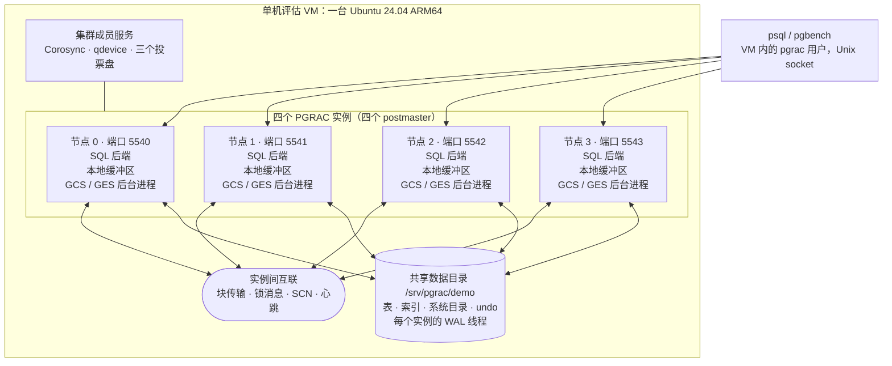

### 1.3 本地 PGDATA 与共享数据

每个实例有自己的 `PGDATA`，只放本实例的启动配置、运行文件和日志；表、索引、系统目录和 undo 都在共享目录里，四个实例看到的是同一份数据。

```mermaid
flowchart LR
    subgraph LOCAL["每个实例独立：/srv/pgrac/demo/nodeN/"]
        direction TB
        CONF["data/postgresql.conf、pgrac.conf<br/>本实例启动配置"]
        RUN["data/postmaster.pid<br/>运行文件"]
        LOG["postgres.log<br/>本实例数据库日志"]
        PGWAL["data/pg_wal<br/>指向本实例 WAL 线程的链接"]
    end
    subgraph SHARE["四个实例共用：/srv/pgrac/demo/"]
        direction TB
        DATA[("data/base、data/global<br/>表 · 索引 · 系统目录")]
        UNDO[("data/pg_undo/instance_0 … 3<br/>各实例的 undo 段")]
        XACT[("data/native_side/origin_0 … 3<br/>各实例的事务状态文件")]
        WAL[("wal/thread_1 … thread_4<br/>每个实例一条 WAL 线程")]
    end
    PGWAL -->|"节点 N 写 thread_(N+1)"| WAL
    CONF -.->|"cluster.shared_data_dir"| DATA
```

| 位置（VM 内） | 内容 | 归属 |
|---|---|---|
| `/srv/pgrac/demo/nodeN/data` | 实例 N 的 `PGDATA`：启动配置、`postmaster.pid`、`pg_wal` 链接 | 每个实例一份 |
| `/srv/pgrac/demo/nodeN/postgres.log` | 实例 N 的数据库日志 | 每个实例一份 |
| `/srv/pgrac/demo/data/` | 表、索引、系统目录（`base/`、`global/`）、undo 段（`pg_undo/`）、事务状态（`native_side/`） | 四个实例共用 |
| `/srv/pgrac/demo/wal/thread_1` … `thread_4` | WAL 线程，节点 N 写 `thread_(N+1)` | 每个实例一条，放在共享目录 |
| `/srv/pgrac/demo/sockets/` | 四个实例的 Unix socket | — |

---

## 2. RAC 特色功能介绍

本节介绍镜像中可以直接观察到的集群功能。每一项后面的「在镜像上观察」都给出可以执行的 SQL，对应的完整步骤在[第 7 章](#7-动手实验)。

> [!NOTE]
> 本节多处查询 `pg_cluster_state` 视图。它每次调用都会采集本节点的全部诊断项，适合在测试中低频查询，不要放进应用的每个事务里。各节点分别统计，同一个计数需要在四个节点上分别查看。

### 2.1 Cache Fusion 与全局缓存服务 GCS

一个实例需要的数据块如果正在另一个实例的缓冲区里，可以经实例间互联直接取得，这就是 Cache Fusion。每个数据块都有一个**资源 master** 节点，按块标识的哈希分布在四个节点上。master 上的 GCS 记录哪个节点以什么模式持有该块，并决定怎样满足新的请求：

| 情况 | 消息路径 | 说明 |
|---|---|---|
| **2-way** | 请求方 → master → 请求方 | master 自己缓存着该块，直接把块发给请求方。 |
| **3-way** | 请求方 → master → 持有方 → 请求方 | master 没有缓存该块，但记录了持有方；master 把请求转给持有方，持有方直接把块发给请求方。之后请求方向 master 登记自己持有的副本。 |
| 共享存储读取 | 请求方 → master → 请求方 | 没有节点缓存该块时，master 授权请求方从共享存储读取。 |
| 写权限转移 | 请求方 → master → 持有方 | 另一个节点要写时，master 让当前持有方让出写权限；持有方先把修改过的块写入共享存储，请求方再取得写权限。 |

除当前块之外，实例之间还会交换一致读需要的旧版本信息（见 [2.7](#27-undo事务表与-itl-组成的多版本)）。

**2-way 传输：**

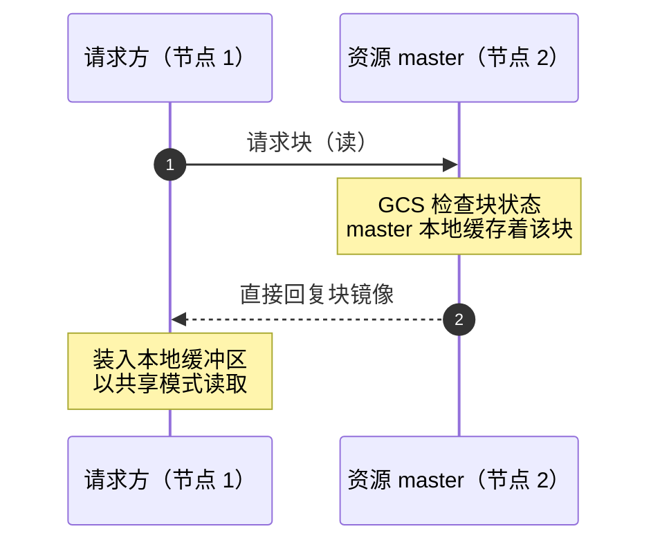

**3-way 传输：**

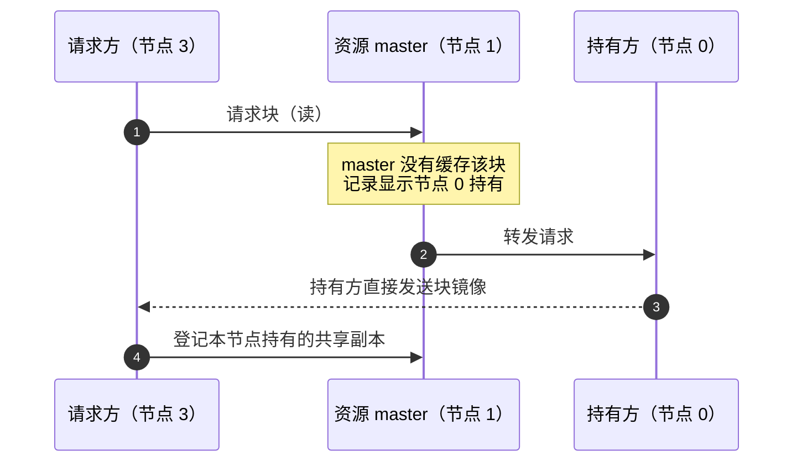

**在镜像上观察：** 在四个节点上分别记录 `gcs`、`pcm` 类计数的基线，操作后再看增量。完整步骤见[实验 3](#实验-3-cache-fusion-块传递)，各列含义如下：

| 列 | 来源（`pg_cluster_state`） | 含义 |
|---|---|---|
| `req` | `gcs` / `block_request_count` | 本节点作为请求方，向其他节点上的 master 请求块的次数 |
| `recv` | `gcs` / `install_copy_count` | 本节点收到并装入本地缓冲区的块镜像数 |
| `shipped` | `gcs` / `block_ship_bytes_total` ÷ 8192 | 本节点发出的块镜像数（按 8 KB 块计） |
| `fwd` | `gcs` / `block_forward_sent_count` | 本节点作为 master，把请求转给持有方的次数（3-way 的第二跳） |
| `holder_ship` | `gcs` / `block_from_holder_ship_count` + `cf_xheld_read_ship_count` | 本节点作为持有方，直接把块发给请求方的次数（3-way 的第三跳） |
| `to_s`、`to_x`、`x_down` | `pcm` / `trans_*_count` | 本节点作为 master 记录的块锁状态转换，见 [2.2](#22-pcm-块锁状态与过去镜像-pi) |

### 2.2 PCM 块锁状态与过去镜像 PI

GCS 用块锁（类似 Oracle RAC 中的 PCM 锁）描述每个节点对一个块的权限：

| 状态 | 含义 |
|---|---|
| `N` | 本节点不持有该块的权限 |
| `S` | 共享模式，多个节点可以同时读 |
| `X` | 独占模式，只有一个节点可以修改 |

一个节点让出 `X` 权限后，可以把自己缓冲区中该块的那份副本保留下来，称为**过去镜像（PI，Past Image）**，供恢复时使用；master 记录哪些节点持有 PI。PI 不是一种锁模式，而是缓冲区中的一类副本。

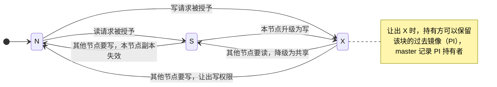

**在镜像上观察：** 每个节点作为 master 管理的块的当前状态，以及累计的状态转换次数。

```bash
for n in 0 1 2 3; do
  pgnode $n -Atc "SELECT current_setting('cluster.node_id') AS node, max(value) FILTER (WHERE key = 'master_state_s_count') AS s_blocks, max(value) FILTER (WHERE key = 'master_state_x_count') AS x_blocks, max(value) FILTER (WHERE key = 'pi_holders_total_count') AS pi_holders FROM pg_cluster_state WHERE category = 'pcm'"
done
```

示例输出（数值随运行时间变化）：

```text
0|312|49|19
1|312|36|0
2|321|39|5
3|286|45|7
```

各列依次为节点号、本节点作为 master 记录为 `S` 的块数、记录为 `X` 的块数、记录的 PI 持有者数。块锁状态转换的增量（`to_s`、`to_x`、`x_down`）见[实验 3](#实验-3-cache-fusion-块传递)。

### 2.3 全局资源目录 GRD

全局资源目录（GRD，Global Resource Directory）记录集群中每个全局资源由哪个节点管理（master）以及当前的授予和等待情况：

- **锁资源**（表锁、事务锁等）：资源标识经哈希落到 4096 个分片之一，分片按节点号轮流分配给四个节点，每个节点管理 1024 个分片。
- **数据块**：按块标识的哈希直接分布在四个节点上，由该节点的 GCS 管理。

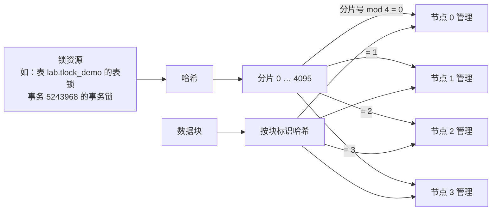

**在镜像上观察：** 分片在四个节点上的分布：

```sql
SELECT master_node_id, count(*) AS shards
FROM pg_cluster_grd_shards
GROUP BY master_node_id
ORDER BY master_node_id;
```

```text
 master_node_id | shards
----------------+--------
              0 |   1024
              1 |   1024
              2 |   1024
              3 |   1024
(4 rows)
```

`pg_cluster_grd_entries` 列出本节点上当前存在的全局锁资源：`type`、`field1`–`field4` 是 PostgreSQL 锁标识的字段（`type = 0` 为表锁，`field1` 为数据库 OID、`field2` 为表 OID；`type = 5` 为事务锁，`field1` 为事务号、`field2` 为发起事务的节点号），`ngranted`、`nwaiters` 为授予数和等待数。与 `pg_cluster_grd_shards` 按 `shard_id` 连接即可看到资源的 master。管理该资源的 master 节点和持锁节点上都能看到对应的行。具体示例见[实验 4](#实验-4-跨节点行锁与表锁)。

### 2.4 全局锁服务 GES

GES（Global Enqueue Service）把需要全局一致的锁请求交给资源的 master 节点裁决，使不同实例上的会话像在同一个实例里一样互相排队：

- **表锁**：一个实例持有与请求冲突的表锁时，其他实例上的请求等待，或在使用 `NOWAIT` 时立即报 `55P03`。
- **行锁**：一行被另一个实例上未提交的事务修改时，本实例要修改同一行的会话等待该事务结束。等待期间，`pg_stat_activity` 显示等待事件 `Cluster: GES` / `GesTxEnqueueWait`。持有方提交后，等待方读取新版本继续执行；持有方回滚时，等待方在原版本上继续。

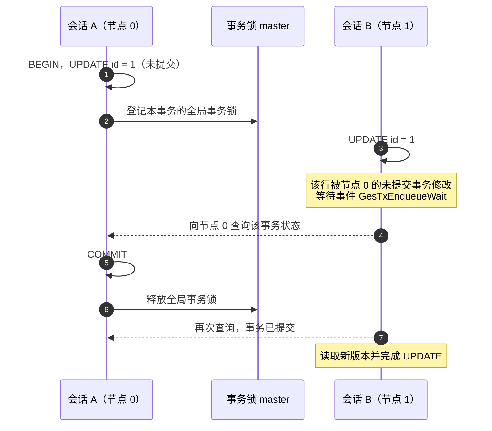

锁模式兼容规则与 PostgreSQL 相同，可以用函数查询：

```sql
SELECT cluster_ges_mode_compat('RowExclusiveLock', 'RowExclusiveLock')   AS rx_vs_rx,
       cluster_ges_mode_compat('AccessShareLock', 'AccessExclusiveLock') AS as_vs_ax;
```

```text
 rx_vs_rx | as_vs_ax
----------+----------
 t        | f
(1 row)
```

`pg_cluster_ges_mode_matrix()` 返回完整的 8×8 兼容矩阵（`held`、`wanted`、`compatible` 及对应的 DLM 模式名）。

**在镜像上观察：** 行锁等待和表锁冲突的完整步骤见[实验 4](#实验-4-跨节点行锁与表锁)。

### 2.5 跨节点死锁检测 LMD

各实例的 `lmd` 进程汇总跨实例的锁等待关系。协调节点（四个节点都在线时为节点 0）定期在全局等待图里查找环路，连续两轮确认后选择一个事务作为牺牲者并取消它的等待，该事务收到 `ERROR: deadlock detected`（SQLSTATE `40P01`），另一个事务继续执行。

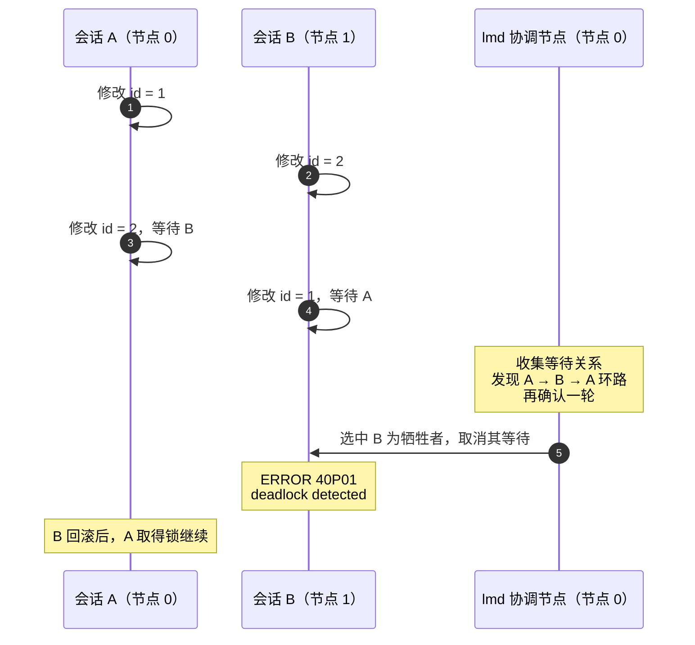

**在镜像上观察：** 协调节点的检测计数：

```sql
SELECT max(value) FILTER (WHERE key = 'cycle_detected_count')     AS cycles,
       max(value) FILTER (WHERE key = 'deadlock_confirmed_count') AS confirmed
FROM pg_cluster_state
WHERE category = 'lmd';
```

`pg_cluster_lmd` 显示 `lmd` 进程的状态（`ready` 表示就绪）。完整步骤见[实验 7](#实验-7-跨节点死锁检测)。

### 2.6 全局 SCN

SCN（System Change Number）是集群的逻辑时钟，各实例用它为写入、提交和快照排序。PGRAC 的 SCN 采用分布式 Lamport 时钟，各实例独立推进，并通过实例间的消息互相同步：

- 本实例写入数据、提交事务时，SCN 前进。
- 实例之间的每条消息（包括心跳、块传输、锁消息）都带上发送方当前的 SCN；接收方发现对方的 SCN 不小于自己时，把自己的 SCN 推进到对方的值加一。
- 事务提交时记录**提交 SCN**；会话取快照时记录**快照 SCN**。读取一行时比较两者：提交 SCN 不大于快照 SCN 的修改才可见。
- 提交时，本实例还会把新的 SCN 广播给其他实例。因此在一个实例上提交后，其他实例随后开始的查询可以看到这次提交（[实验 2](#实验-2-跨节点读写一致性)演示了这一点）。

SCN 是 64 位整数：高 8 位是产生它的节点号，低 56 位是计数。比较先后时只比较计数部分。

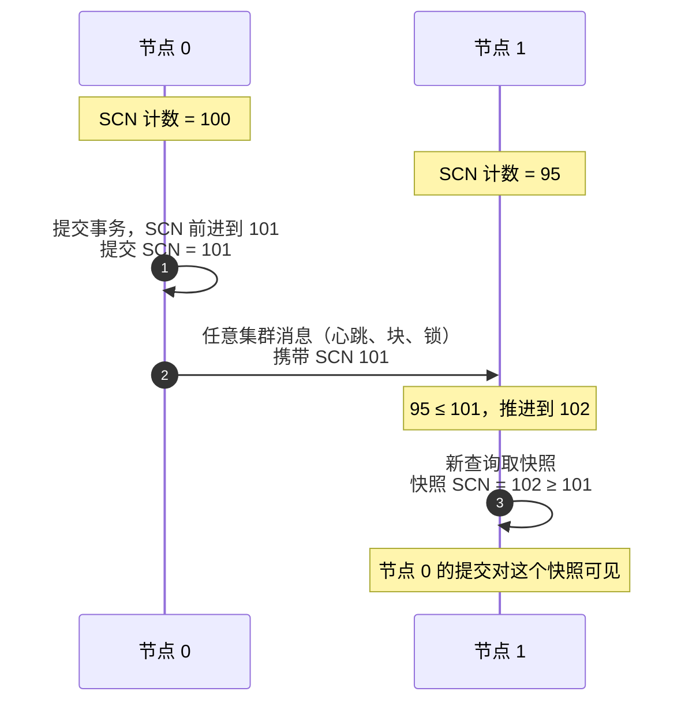

**在镜像上观察：**

```bash
for n in 0 1 2 3; do
  pgnode $n -Atc "SELECT current_setting('cluster.node_id') AS node, cluster_scn_current() >> 56 AS scn_node, cluster_scn_current() & ((1::bigint << 56) - 1) AS scn_counter"
done
```

四个节点的计数部分彼此接近，并持续前进；高 8 位等于各自的节点号。提交 SCN 记录在 WAL 的提交记录中，可用 `pg_waldump` 查看，见[实验 8](#实验-8-全局-scnwal-线程与共享文件)。

### 2.7 Undo、事务表与 ITL 组成的多版本

PGRAC 的多版本由三部分组成：

| 组成 | 位置 | 作用 |
|---|---|---|
| **Undo 段** | 共享目录 `data/pg_undo/instance_N/`，每个实例一组 | 每次修改时写入一条 undo 记录，保存修改前的内容 |
| **事务表（TT）** | 每个 undo 段的段头 | 每个事务一个槽位，记录事务状态和提交 SCN |
| **ITL** | 每个数据块内的一组槽位 | 记录正在或曾经修改本块的事务、它的 undo 位置和 SCN |

读取时，如果块上某个修改的 SCN 比查询的快照 SCN 新，PGRAC 沿 ITL 找到对应的 undo 记录，把这些修改逆向撤销，得到快照时刻的版本：可以在本实例复制当前块并逐条撤销，构造整块的一致读（CR）副本；也可以向修改所在的实例取得旧版本和事务状态。无法确定版本时返回明确的错误，而不会返回不确定的数据。

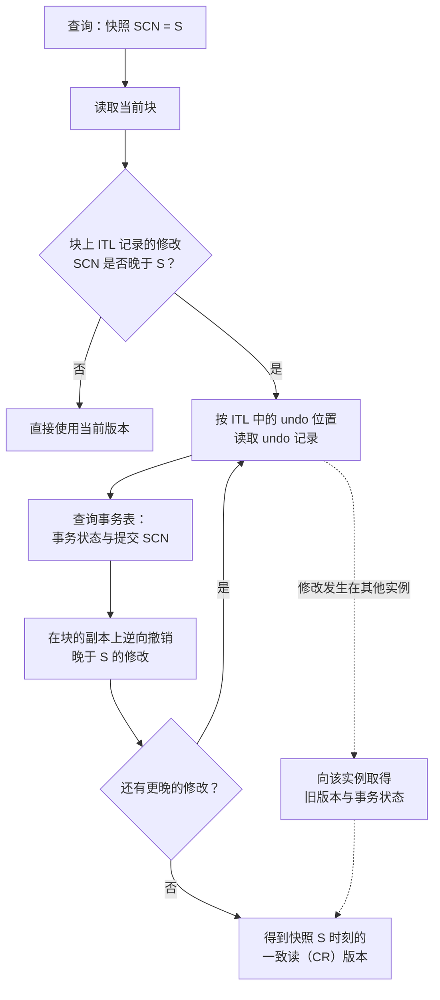

**在镜像上观察：** 每修改一行，本实例写一条 undo 记录：

```bash
pgnode 1 -c "SELECT key, value FROM pg_cluster_state WHERE category = 'undo' AND key IN ('segment_allocated_count', 'record_alloc_count') ORDER BY key" -c "BEGIN" -c "UPDATE lab.accounts SET balance = balance + 1 WHERE id BETWEEN 100 AND 109" -c "COMMIT" -c "SELECT key, value FROM pg_cluster_state WHERE category = 'undo' AND key IN ('segment_allocated_count', 'record_alloc_count') ORDER BY key"
```

修改 10 行之后，`record_alloc_count` 至少增加 10（每修改一行至少写一条 undo 记录，实测增加 16–20）；`segment_allocated_count` 是本实例已分配的 undo 段数。`pg_waldump` 显示的提交记录中，`tt_commit` 部分就是事务表槽位和提交 SCN，见[实验 8](#实验-8-全局-scnwal-线程与共享文件)。

### 2.8 多节点并发提交与一致读

四个实例都可以同时执行写事务并各自提交。提交在本实例的 WAL 线程中持久化，提交 SCN 经集群消息传播；其他实例随后开始的语句或事务可以读到已提交的结果。

一个查询在整个执行期间看到的是它开始时的快照：

- 默认的 `READ COMMITTED` 下，每条语句使用自己开始时的快照；一条长时间运行的语句不会看到执行期间其他实例提交的修改。
- `REPEATABLE READ` 事务内的所有语句使用同一个快照，直到事务结束。

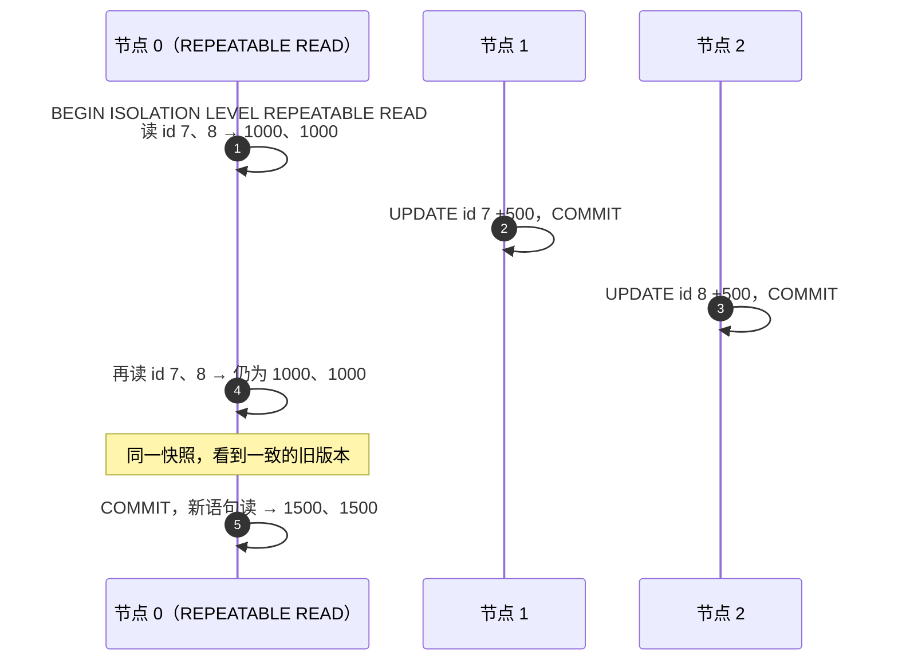

**在镜像上观察：** [实验 5](#实验-5-一致读)演示一致读，[实验 6](#实验-6-多节点并发提交)用 pgbench 在四个节点上并发提交，再核对四个节点读到的总数一致。

### 2.9 每实例独立的 WAL 线程与统一的数据文件

每个实例只写自己的一条 WAL 线程，线程号为节点号加一：节点 0 写 `thread_1`，节点 3 写 `thread_4`。各线程放在共享目录 `/srv/pgrac/demo/wal/` 下，本实例 `PGDATA` 中的 `pg_wal` 是指向它的链接。表和索引的数据文件只有一份，位于共享数据目录。每条 WAL 记录带有线程号和 SCN，`pg_waldump` 输出中的 `thread`、`scn` 字段就是这两项。

**在镜像上观察：**

```sql
SELECT key, value
FROM pg_cluster_state
WHERE category = 'wal_thread' AND key IN ('thread_id', 'writer_node_id')
ORDER BY key;
```

在节点 0 上执行，`thread_id` 为 `1`，`writer_node_id` 为 `0`。查看线程目录和数据文件位置的步骤见[实验 8](#实验-8-全局-scnwal-线程与共享文件)。

### 2.10 集群成员管理与 quorum

集群成员状态由以下机制共同维护：

- `cssd` 进程在数据库实例之间发送心跳，把每个对端标为 `alive`、`suspected` 或 `dead`。
- `qvotec` 进程周期性读写投票盘；可用投票盘达到多数（本镜像 3 个投票盘中至少 2 个）时，本实例处于 quorum 中。
- 集群成员视图记录每个声明节点的成员状态（`member` 表示已被接纳为成员）和接纳时的 epoch。

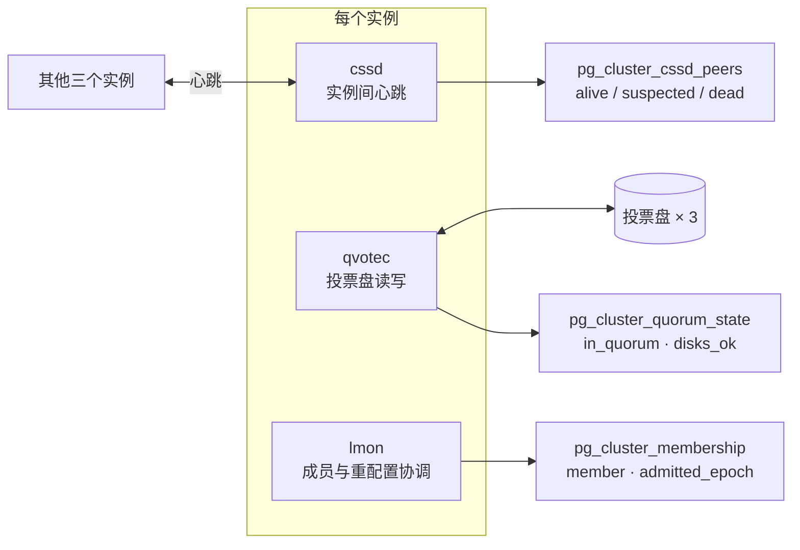

**在镜像上观察：** 见[实验 1](#实验-1-集群状态检查)。

### 2.11 后台进程分工

下表的进程名与 `pg_stat_activity.backend_type` 一致：

| 进程 | 作用 |
|---|---|
| `lmon` | 处理集群成员和重配置协调，并承担相关控制消息的发送与处理。 |
| `lms` / `lms worker` | 处理跨节点块访问、块镜像及事务状态请求。本镜像每实例 1 个 `lms` 和 1 个 `lms worker`。 |
| `lmd` | 处理分布式锁等待图、死锁检测及相应取消工作。 |
| `lck` | 锁辅助进程的生命周期、就绪和状态管理。 |
| `cssd` | 处理数据库侧节点心跳及对端状态。 |
| `qvotec` | 处理投票、法定多数与存储服务资格检查。 |
| `sinval broadcaster` | 接收并应用跨节点共享缓存失效通知，供数据字典等缓存保持一致。 |
| `undo cleaner` | 清理可回收的 undo、事务表及相关残留事务引用；每实例 8 个。 |
| `cluster stats` | 汇集集群运行统计，供诊断视图使用。 |
| `diag` | 执行集群诊断与长等待采样。 |

此外还有 PostgreSQL 原有的 `checkpointer`、`background writer`、`walwriter` 等进程。

**在镜像上观察：** 见[实验 1](#实验-1-集群状态检查)第 5 步。

---

## 3. 准备 Mac 环境

| 项目 | 要求 |
|---|---|
| CPU | Apple Silicon ARM64，至少 16 个 CPU 核心 |
| 内存 | 至少 96 GiB；建议 128 GiB，启动前为 VM 留出 64 GiB |
| 磁盘 | 至少 160 GB 可用空间 |
| macOS | macOS 15 或更新版本 |
| 工具 | Lima 2.2.0 或更新版本、QEMU 磁盘工具、zstd |

在 Mac 终端安装工具并确认版本：

```bash
brew install lima qemu zstd
limactl --version
sysctl -n hw.logicalcpu hw.memsize
```

`limactl --version` 应显示 `limactl version 2.2.0` 或更新版本。

## 4. 下载、校验与合并分卷

从 [v0.135.0 Release](https://github.com/sqlrush/pgrac/releases/tag/v0.135.0) 下载以下四个资产到同一个新目录：

| 文件 | 说明 |
|---|---|
| `pre2-single-v0.135.0-arm64.tar.zst.part-000` | 镜像归档分卷（本版本只有 1 个分卷） |
| `SHA256SUMS` | 各分卷的 SHA-256 校验值 |
| `ARCHIVE-SHA256SUMS` | 合并后归档的 SHA-256 校验值 |
| `DELIVERY-README.md` | 交付说明 |

也可以在 Mac 终端用 `curl` 下载：

```bash
mkdir -p ~/pgrac-pre2 && cd ~/pgrac-pre2
for f in pre2-single-v0.135.0-arm64.tar.zst.part-000 SHA256SUMS ARCHIVE-SHA256SUMS DELIVERY-README.md; do
  curl -fL -O "https://github.com/sqlrush/pgrac/releases/download/v0.135.0/$f"
done
```

校验分卷、合并、校验归档，然后解压并校验解压后的文件：

```bash
shasum -a 256 -c SHA256SUMS
cat pre2-single-v0.135.0-arm64.tar.zst.part-* > pre2-single-v0.135.0-arm64.tar.zst
shasum -a 256 -c ARCHIVE-SHA256SUMS
zstd -d -c pre2-single-v0.135.0-arm64.tar.zst | tar -xf -
cd pre2-single-v0.135.0-arm64
shasum -a 256 -c FILES-SHA256SUMS
shasum -a 256 -c IMAGE-SHA256SUMS
```

预期每一项都显示 `OK`，例如：

```text
pre2-single-v0.135.0-arm64.tar.zst.part-000: OK
pre2-single-v0.135.0-arm64.tar.zst: OK
BUNDLE.json: OK
...
vm-image.md: OK
pre2-single-arm64.qcow2: OK
```

解压目录包含虚拟磁盘 `pre2-single-arm64.qcow2`、Lima 配置 `pre2-single.yaml`、`start.sh` / `stop.sh` / `test.sh` / `control.sh` 等脚本和随包文档。请保留原始下载文件，以后可以用它们导入新的副本。

## 5. 安装与启动

在解压目录 `pre2-single-v0.135.0-arm64` 中执行：

```bash
./start.sh
```

第一次执行时创建名为 `pgrac-pre2-single` 的 Lima VM，启动 VM 和四个数据库实例。成功时最后输出：

```json
{
  "status": "STARTED",
  "seconds": 21.376367467999998,
  "pid": 1489,
  "nodes": [
    0,
    1,
    2,
    3
  ]
}
```

查看四个实例的运行状态，并运行随包的示例检查：

```bash
./control.sh status
./test.sh
```

如果 `./start.sh` 没有输出 `STARTED`，按[第 9 章](#9-遇到异常时)处理。

`./control.sh status` 中四个 `instances` 的 `rc` 都为 `0`，`stdout` 显示 `server is running`。`./test.sh` 检查四个实例读到的示例表行数、主键唯一性和更新结果，成功时输出：

```json
{
  "status": "EXAMPLE_PASS",
  "nodes": 4,
  "rows": 50000,
  "transactions": 4
}
```

> [!TIP]
> 如需同时保留另一个全新副本，选择新名称并在该副本的所有命令前设置同一个环境变量，例如 `export PGRAC_VM=pgrac-pre2-single-eval02`。名称只能是 `pgrac-pre2-single` 或 `pgrac-pre2-single-<后缀>`。下文命令中的 `"${PGRAC_VM:-pgrac-pre2-single}"` 会自动使用这个名称。

## 6. 连接四个节点

SQL 在 VM 内以 `pgrac` 用户通过 Unix socket 连接，使用 peer 身份认证，不需要密码；镜像不对 Mac 或外部网络开放数据库端口。

| 节点 | 端口 | 数据目录 |
|---|---|---|
| 0 | `5540` | `/srv/pgrac/demo/node0/data` |
| 1 | `5541` | `/srv/pgrac/demo/node1/data` |
| 2 | `5542` | `/srv/pgrac/demo/node2/data` |
| 3 | `5543` | `/srv/pgrac/demo/node3/data` |

**第 1 步：进入 VM。** 在 Mac 终端执行：

```bash
limactl shell "${PGRAC_VM:-pgrac-pre2-single}"
```

提示符变为 `pgrac@lima-pgrac-pre2-single:~$`，表示已进入 VM。

**第 2 步：设置 psql 环境（只需做一次）。** 在 VM 中执行下面的命令，把 psql 路径、连接参数和快捷命令 `pgnode` 写入 `~/.bashrc`：

```bash
cat >> ~/.bashrc <<'EOF2'

# PGRAC 测试手册：psql 环境与 pgnode 快捷命令
export PATH=/opt/pgrac/bin:$PATH
export LD_LIBRARY_PATH=/opt/pgrac/lib
export PGHOST=/srv/pgrac/demo/sockets PGUSER=pgrac PGDATABASE=postgres
pgnode() { psql -X -p $((5540 + $1)) -v PROMPT1="node$1=%# " -v PROMPT2="node$1-%# " "${@:2}"; }
EOF2
source ~/.bashrc
```

之后每次执行 `limactl shell` 进入 VM，这些设置都会自动生效。

**第 3 步：连接节点。** `pgnode N` 打开节点 N 的 psql，提示符显示节点号：

```text
pgrac@lima-pgrac-pre2-single:~$ pgnode 2
psql (16.13)
Type "help" for help.

node2=# SELECT current_setting('cluster.node_id') AS node;
 node
------
 2
(1 row)

node2=# \q
```

`pgnode` 后面可以接任意 psql 参数，例如 `pgnode 0 -Atc "SELECT 1"` 在节点 0 上执行一条语句后退出。不用快捷命令时，等价的完整写法是：

```bash
psql -X -h /srv/pgrac/demo/sockets -p 5540 -U pgrac -d postgres
```

也可以在 Mac 上用随包入口执行单条 SQL，不进入 VM：

```bash
limactl shell "${PGRAC_VM:-pgrac-pre2-single}" -- \
  sudo /usr/local/sbin/pgrac-single sql --node 1 \
  --query "SELECT current_setting('cluster.node_id'), count(*) FROM demo.idx_lookup"
```

输出中的 `"stdout": "1|50000\n"` 是节点 1 返回的结果。

> [!TIP]
> 第 7 章的实验需要同时使用多个会话。每个会话在 Mac 上打开一个终端窗口，执行 `limactl shell "${PGRAC_VM:-pgrac-pre2-single}"` 进入 VM，再用 `pgnode N` 连接指定节点。文中用「终端 A（节点 0）」这样的标注说明每一步在哪个终端执行。

---

## 7. 动手实验

每个实验按「目的 / 步骤 / 预期结果 / 你看到了什么 RAC 特性」组织。示例输出来自本镜像的实测；事务号、SCN、分片号、计数器等数值在你的环境中会不同，按说明比较即可。

> [!TIP]
> 实验按顺序进行，后面的实验使用 7.0 创建的表。实验中的事务都只用 `BEGIN`、`COMMIT`、`ROLLBACK`；每个节点同时打开的会话不超过 4 个。

### 7.0 准备实验数据

镜像预装了示例表 `demo.idx_lookup`（50,000 行）。实验另外使用 `lab` schema 下的四张小表，在**节点 0** 上执行一次即可：

```bash
pgnode 0
```

```sql
CREATE SCHEMA lab;

CREATE TABLE lab.accounts (
    id      integer PRIMARY KEY,
    balance bigint  NOT NULL
);
INSERT INTO lab.accounts (id, balance)
SELECT g, 1000 FROM generate_series(1, 10000) AS g;

CREATE TABLE lab.hot (
    id integer PRIMARY KEY,
    v  integer NOT NULL
);
INSERT INTO lab.hot SELECT g, 0 FROM generate_series(1, 20) AS g;

CREATE TABLE lab.lock_demo (
    id integer PRIMARY KEY,
    v  integer NOT NULL
);
INSERT INTO lab.lock_demo VALUES (1, 0), (2, 0);

CREATE TABLE lab.tlock_demo (
    id integer PRIMARY KEY
);
INSERT INTO lab.tlock_demo VALUES (1);

ANALYZE lab.accounts;
ANALYZE lab.hot;
ANALYZE lab.lock_demo;
ANALYZE lab.tlock_demo;
```

退出 psql（`\q`），在 VM shell 中确认其他三个节点立即看到新表和数据：

```bash
for n in 1 2 3; do
  pgnode $n -Atc "SELECT current_setting('cluster.node_id') AS node, count(*) AS accounts, sum(balance) AS total FROM lab.accounts"
done
```

```text
1|10000|10000000
2|10000|10000000
3|10000|10000000
```

| 表 | 用途 |
|---|---|
| `lab.accounts` | 10,000 个账户，余额各 1000；用于读写一致性、一致读和并发提交 |
| `lab.hot` | 20 行小表，所有行在同一个块里；用于观察块传递 |
| `lab.lock_demo` | 2 行；用于行锁等待和死锁检测 |
| `lab.tlock_demo` | 1 行；用于表锁冲突 |

> [!TIP]
> 这些表在整个测试过程中保留即可，不需要删除。需要一套干净的环境时，按[第 9 章](#9-遇到异常时)导入一个新副本。

### 实验 1 集群状态检查

**目的**：确认四个实例都已加入集群、处于 quorum 中，心跳和互联正常，集群后台进程齐全。

**步骤**：在 VM 中连接节点 0（`pgnode 0`），依次执行：

1. 成员状态：

   ```sql
   SELECT n.node_id, n.is_self, m.state, m.admitted_epoch, m.removed
   FROM pg_cluster_nodes AS n
   LEFT JOIN pg_cluster_membership AS m USING (node_id)
   ORDER BY n.node_id;
   ```

   ```text
    node_id | is_self | state  | admitted_epoch | removed
   ---------+---------+--------+----------------+---------
          0 | t       | member |              2 | f
          1 | f       | member |              2 | f
          2 | f       | member |              2 | f
          3 | f       | member |              2 | f
   (4 rows)
   ```

   四个节点的 `admitted_epoch` 相同；它在每次集群重新启动后会变化，首次启动时为 `2`。

2. quorum：

   ```sql
   SELECT in_quorum, quorum_size, disks_ok, disks_total, collision_state
   FROM pg_cluster_quorum_state;
   ```

   ```text
    in_quorum | quorum_size | disks_ok | disks_total | collision_state
   -----------+-------------+----------+-------------+-----------------
    t         |           2 |        3 |           3 | none
   (1 row)
   ```

3. 实例间心跳：

   ```sql
   SELECT node_id, state, heartbeat_send_count, heartbeat_recv_count
   FROM pg_cluster_cssd_peers
   ORDER BY node_id;
   ```

   ```text
    node_id | state | heartbeat_send_count | heartbeat_recv_count
   ---------+-------+----------------------+----------------------
          0 | alive |                    0 |                    0
          1 | alive |                   21 |                   22
          2 | alive |                   22 |                   23
          3 | alive |                   22 |                   23
   (4 rows)
   ```

   本节点自身一行（这里是 `node_id = 0`）的计数为 0；其他节点的计数随时间增长。

4. 互联连接：

   ```sql
   SELECT node_id, state, heartbeat_recv_count, bytes_recv > 0 AS has_traffic
   FROM pg_cluster_ic_peers
   WHERE node_id <> current_setting('cluster.node_id')::int
   ORDER BY node_id;
   ```

   ```text
    node_id |   state   | heartbeat_recv_count | has_traffic
   ---------+-----------+----------------------+-------------
          1 | connected |                   43 | t
          2 | connected |                   44 | t
          3 | connected |                   44 | t
   (3 rows)
   ```

5. 集群后台进程：

   ```sql
   SELECT backend_type, count(*) AS processes
   FROM pg_stat_activity
   WHERE backend_type IN ('lmon', 'lms', 'lms worker', 'lmd', 'lck', 'cssd', 'qvotec',
                          'diag', 'cluster stats', 'sinval broadcaster', 'undo cleaner')
   GROUP BY backend_type
   ORDER BY backend_type;
   ```

   ```text
       backend_type    | processes
   --------------------+-----------
    cluster stats      |         1
    cssd               |         1
    diag               |         1
    lck                |         1
    lmd                |         1
    lmon               |         1
    lms                |         1
    lms worker         |         1
    qvotec             |         1
    sinval broadcaster |         1
    undo cleaner       |         8
   (11 rows)
   ```

6. 退出 psql，在 VM shell 中查看每个实例自己的运行状态，以及四个实例读到的示例表：

   ```bash
   for n in 0 1 2 3; do
     pgnode $n -Atc "SELECT node_id, role, state, pg_version FROM pg_stat_cluster_nodes"
   done
   for n in 0 1 2 3; do
     pgnode $n -Atc "SELECT current_setting('cluster.node_id') AS node, count(*), count(DISTINCT id) FROM demo.idx_lookup"
   done
   ```

   ```text
   0|primary|online|16.13
   1|primary|online|16.13
   2|primary|online|16.13
   3|primary|online|16.13
   0|50000|50000
   1|50000|50000
   2|50000|50000
   3|50000|50000
   ```

**预期结果**：四个节点都是 `member`，`in_quorum = t`，`disks_ok = 3`；三个对端为 `alive` 和 `connected`；每个实例都有上表列出的集群后台进程；四个实例读到相同的 50,000 行。

**你看到了什么 RAC 特性**：集群成员管理（`pg_cluster_membership`）、基于投票盘的 quorum（`pg_cluster_quorum_state`）、实例间心跳（`pg_cluster_cssd_peers`）、实例间互联（`pg_cluster_ic_peers`），以及承担 GCS / GES 工作的后台进程。四个实例读到同一份共享数据。

### 实验 2 跨节点读写一致性

**目的**：在一个节点写入并提交，其他节点立即读到；在另一个节点修改后，原节点读到最新结果。

**步骤**：

1. **终端 A（节点 0）** 执行 `pgnode 0`，写入并提交：

   ```sql
   BEGIN;
   INSERT INTO lab.accounts (id, balance) VALUES (10001, 500);
   UPDATE lab.accounts SET balance = balance + 10 WHERE id = 1;
   COMMIT;
   ```

2. 分别在节点 1、2、3 上读取（可以用终端 B、C、D 执行 `pgnode 1`、`pgnode 2`、`pgnode 3`）：

   ```sql
   SELECT current_setting('cluster.node_id') AS node, id, balance
   FROM lab.accounts
   WHERE id IN (1, 10001)
   ORDER BY id;
   ```

   节点 1 的输出：

   ```text
    node |  id   | balance
   ------+-------+---------
    1    |     1 |    1010
    1    | 10001 |     500
   (2 rows)
   ```

3. **终端 C（节点 2）** 把 `id = 1` 改回原值，并删除新行：

   ```sql
   BEGIN;
   UPDATE lab.accounts SET balance = balance - 10 WHERE id = 1;
   DELETE FROM lab.accounts WHERE id = 10001;
   COMMIT;
   ```

4. **终端 A（节点 0）** 再读：

   ```sql
   SELECT id, balance FROM lab.accounts WHERE id IN (1, 10001) ORDER BY id;
   SELECT count(*), sum(balance) FROM lab.accounts;
   ```

   ```text
    id | balance
   ----+---------
     1 |    1000
   (1 row)

    count |   sum
   -------+----------
    10000 | 10000000
   (1 row)
   ```

**预期结果**：节点 1、2、3 都读到 `1010` 和新行 `10001`；节点 2 的修改提交后，节点 0 读到 `1000`，新行已删除，表回到 10,000 行、总额 10,000,000。

**你看到了什么 RAC 特性**：多实例读写同一份共享数据。提交后，SCN 随集群消息传播，其他实例新开始的语句立即看到结果；被修改的块经 Cache Fusion 在实例间传递。

### 实验 3 Cache Fusion 块传递

**目的**：让同一个块在四个节点之间被读取和修改，用计数器增量观察块的传递路径和块锁状态转换。

**步骤**：打开四个终端，分别连接四个节点：**终端 A** `pgnode 0`、**终端 B** `pgnode 1`、**终端 C** `pgnode 2`、**终端 D** `pgnode 3`。

1. 在**四个终端中都**执行一次预热查询和下面的基线查询。`\gset cf_` 把这一行结果保存为本会话的变量 `:cf_req`、`:cf_recv` 等：

   ```sql
   SELECT count(*) FROM lab.hot;

   SELECT max(value) FILTER (WHERE key = 'block_request_count')::bigint          AS req,
          max(value) FILTER (WHERE key = 'install_copy_count')::bigint           AS recv,
          max(value) FILTER (WHERE key = 'block_ship_bytes_total')::bigint / 8192 AS shipped,
          max(value) FILTER (WHERE key = 'block_forward_sent_count')::bigint     AS fwd,
          max(value) FILTER (WHERE key = 'block_from_holder_ship_count')::bigint
        + max(value) FILTER (WHERE key = 'cf_xheld_read_ship_count')::bigint     AS holder_ship,
          max(value) FILTER (WHERE key = 'trans_n_to_s_count')::bigint           AS to_s,
          max(value) FILTER (WHERE key = 'trans_n_to_x_count')::bigint
        + max(value) FILTER (WHERE key = 'trans_s_to_x_upgrade_count')::bigint   AS to_x,
          max(value) FILTER (WHERE key = 'trans_x_to_n_downgrade_count')::bigint
        + max(value) FILTER (WHERE key = 'trans_x_to_s_downgrade_count')::bigint AS x_down
   FROM pg_cluster_state
   WHERE category IN ('gcs', 'pcm') \gset cf_
   ```

2. **A：读共享。** 终端 A（节点 0）修改一行并提交：

   ```sql
   BEGIN;
   UPDATE lab.hot SET v = v + 1 WHERE id = 1;
   COMMIT;
   ```

   然后依次在终端 B、C、D（节点 1、2、3）读取这一行：

   ```sql
   SELECT id, v FROM lab.hot WHERE id = 1;
   ```

   三个节点都读到 `v = 1`。

3. 在**四个终端中都**执行增量查询：

   ```sql
   SELECT current_setting('cluster.node_id') AS node,
          max(value) FILTER (WHERE key = 'block_request_count')::bigint - :cf_req              AS req,
          max(value) FILTER (WHERE key = 'install_copy_count')::bigint - :cf_recv              AS recv,
          max(value) FILTER (WHERE key = 'block_ship_bytes_total')::bigint / 8192 - :cf_shipped AS shipped,
          max(value) FILTER (WHERE key = 'block_forward_sent_count')::bigint - :cf_fwd         AS fwd,
          max(value) FILTER (WHERE key = 'block_from_holder_ship_count')::bigint
        + max(value) FILTER (WHERE key = 'cf_xheld_read_ship_count')::bigint - :cf_holder_ship AS holder_ship,
          max(value) FILTER (WHERE key = 'trans_n_to_s_count')::bigint - :cf_to_s             AS to_s,
          max(value) FILTER (WHERE key = 'trans_n_to_x_count')::bigint
        + max(value) FILTER (WHERE key = 'trans_s_to_x_upgrade_count')::bigint - :cf_to_x     AS to_x,
          max(value) FILTER (WHERE key = 'trans_x_to_n_downgrade_count')::bigint
        + max(value) FILTER (WHERE key = 'trans_x_to_s_downgrade_count')::bigint - :cf_x_down AS x_down
   FROM pg_cluster_state
   WHERE category IN ('gcs', 'pcm');
   ```

   实测的四个节点输出（合并显示）：

   ```text
    node | req | recv | shipped | fwd | holder_ship | to_s | to_x | x_down
   ------+-----+------+---------+-----+-------------+------+------+--------
    0    |   0 |    2 |      43 |   0 |          34 |    0 |    2 |      2
    1    |   3 |    5 |       4 |  10 |           0 |    0 |    0 |      0
    2    |   5 |    5 |       4 |   1 |           0 |    0 |    0 |      0
    3    |   5 |    5 |       0 |   0 |           0 |    0 |    0 |      0
   ```

4. **B：写权限轮转。** 在四个终端中**再执行一次**第 1 步的基线查询（`\gset cf_` 那条），然后按 A → B → C → D → A → B → C → D 的顺序，每个终端各执行一次（共两轮）：

   ```sql
   BEGIN;
   UPDATE lab.hot SET v = v + 1 WHERE id = 1;
   COMMIT;
   ```

   在终端 D 读取结果：

   ```sql
   SELECT id, v FROM lab.hot WHERE id = 1;
   ```

   ```text
    id | v
   ----+---
     1 | 9
   (1 row)
   ```

5. 在四个终端中再执行一次第 3 步的增量查询。实测输出（合并显示）：

   ```text
    node | req | recv | shipped | fwd | holder_ship | to_s | to_x | x_down
   ------+-----+------+---------+-----+-------------+------+------+--------
    0    |   0 |    4 |       6 |  10 |           6 |    0 |    7 |      7
    1    |   6 |   10 |       5 |   0 |           5 |    0 |    0 |      0
    2    |   5 |    9 |       6 |   1 |           5 |    0 |    0 |      0
    3    |   5 |    9 |       2 |   3 |           2 |    0 |    6 |      6
   ```

**预期结果**：

- 读共享（第 3 步）：读取的节点（1、2、3）`req`、`recv` 增加，说明块从其他节点传来；某个节点的 `fwd` 增加（上例为节点 1），它是这个块的资源 master，把请求转给了持有方；写入该行的节点 0 作为持有方，`shipped`、`holder_ship` 增加，直接把块发给请求方。这就是 3-way 传输。
- 写权限轮转（第 5 步）：四个节点的 `recv` 都增加；相关块的 master 节点上 `to_x` 和 `x_down` 成对增加（上例为节点 0 和 3），每次写权限从一个节点转到下一个节点都记一次。最终 `v = 9`（第 2 步 1 次加上第 4 步 8 次）。
- 后台进程也会产生少量块传输，计数不必与操作次数一一对应；哪个节点充当 master 取决于块标识的哈希，你的环境中可能是其他节点。

**你看到了什么 RAC 特性**：Cache Fusion 的 3-way 块传输（请求方 → master → 持有方 → 请求方）、master 上的 GCS 对块锁状态 `N`/`S`/`X` 的管理，以及写权限在实例间的转移。

### 实验 4 跨节点行锁与表锁

#### 4A 行锁等待

**目的**：节点 0 修改一行但不提交，节点 1 修改同一行时进入全局等待；节点 0 提交后节点 1 继续。

**步骤**：使用三个终端：**终端 A** `pgnode 0`、**终端 B** `pgnode 1`、**终端 C** 停留在 VM shell。

1. 终端 B（节点 1）记录等待计数的基线：

   ```sql
   SELECT key, value
   FROM pg_cluster_state
   WHERE category = 'ges' AND key IN ('tx_enqueue_wait_count', 'tx_enqueue_timeout_count')
   ORDER BY key;
   ```

   ```text
              key            | value
   --------------------------+-------
    tx_enqueue_timeout_count | 0
    tx_enqueue_wait_count    | 0
   (2 rows)
   ```

2. 终端 A（节点 0）修改一行，**先不提交**，并记下本事务的事务号：

   ```sql
   BEGIN;
   UPDATE lab.lock_demo SET v = v + 100 WHERE id = 1;
   SELECT txid_current() AS node0_xid;
   ```

   ```text
    node0_xid
   -----------
      5243968
   (1 row)
   ```

3. 终端 B（节点 1）修改同一行，语句进入等待：

   ```sql
   \timing on
   BEGIN;
   UPDATE lab.lock_demo SET v = v + 1 WHERE id = 1;
   ```

4. 终端 C（VM shell）观察节点 1 上的等待：

   ```bash
   pgnode 1 -c "SELECT pid, wait_event_type, wait_event, left(query, 50) AS query FROM pg_stat_activity WHERE wait_event_type LIKE 'Cluster:%' AND backend_type = 'client backend'"
   ```

   ```text
    pid  | wait_event_type |    wait_event    |                      query
   ------+-----------------+------------------+--------------------------------------------------
    4880 | Cluster: GES    | GesTxEnqueueWait | UPDATE lab.lock_demo SET v = v + 1 WHERE id = 1;
   (1 row)
   ```

   再在四个节点上查看节点 0 这个事务的全局事务锁资源（把 `XID` 换成第 2 步的实际值）：

   ```bash
   XID=5243968
   for n in 0 1 2 3; do
     pgnode $n -Atc "SELECT current_setting('cluster.node_id') AS node, e.shard_id, s.master_node_id, e.field1 AS xid, e.field2 AS origin_node, e.ngranted FROM pg_cluster_grd_entries AS e JOIN pg_cluster_grd_shards AS s USING (shard_id) WHERE e.type = 5 AND e.field1 = $XID"
   done
   ```

   ```text
   0|3826|2|5243968|0|1
   2|3826|2|5243968|0|1
   ```

   各列依次为查询所在节点、分片号、分片的 master 节点、事务号、发起事务的节点和授予数。持锁的节点 0 和分片的 master（上例为节点 2，`3826 mod 4 = 2`）上都能看到这个已授予（`ngranted = 1`）的事务锁；如果分片的 master 恰好是节点 0，只显示一行。

5. 终端 A（节点 0）提交：

   ```sql
   COMMIT;
   ```

   终端 B 的 `UPDATE` 随即完成：

   ```text
   UPDATE 1
   Time: 3860.615 ms (00:03.861)
   ```

6. 终端 B（节点 1）提交并读取，再查看等待计数：

   ```sql
   COMMIT;
   SELECT id, v FROM lab.lock_demo WHERE id = 1;
   SELECT key, value
   FROM pg_cluster_state
   WHERE category = 'ges' AND key IN ('tx_enqueue_wait_count', 'tx_enqueue_timeout_count')
   ORDER BY key;
   ```

   ```text
    id |  v
   ----+-----
     1 | 101
   (1 row)

              key            | value
   --------------------------+-------
    tx_enqueue_timeout_count | 0
    tx_enqueue_wait_count    | 1
   (2 rows)
   ```

**预期结果**：节点 1 的 `UPDATE` 一直等待，`wait_event` 为 `GesTxEnqueueWait`；节点 0 提交后约 1 秒内完成（`Time` 约等于你在两步之间停留的时间）。最终 `v = 101`，两次修改都保留。节点 1 的 `tx_enqueue_wait_count` 加 1。

> [!TIP]
> 让持锁事务在 30 秒内提交或回滚。若在第 5 步改为执行 `ROLLBACK;`，节点 1 会在原值上完成修改，最终 `v` 为原值加 1。

#### 4B 表锁冲突

**目的**：节点 0 持有表的排他锁时，其他节点的表锁请求由 GES 判定为冲突；节点 0 释放后，请求立即成功。

**步骤**：

1. 任一终端查询锁模式兼容性：

   ```sql
   SELECT cluster_ges_mode_compat('RowExclusiveLock', 'RowExclusiveLock')   AS rx_vs_rx,
          cluster_ges_mode_compat('AccessShareLock', 'AccessExclusiveLock') AS as_vs_ax;
   ```

   ```text
    rx_vs_rx | as_vs_ax
   ----------+----------
    t        | f
   (1 row)
   ```

2. 终端 A（节点 0）对 `lab.tlock_demo` 加排他锁，先不提交：

   ```sql
   BEGIN;
   LOCK TABLE lab.tlock_demo IN ACCESS EXCLUSIVE MODE;
   ```

3. 终端 C（VM shell）在四个节点上查看这张表的全局表锁资源：

   ```bash
   for n in 0 1 2 3; do
     pgnode $n -Atc "SELECT current_setting('cluster.node_id') AS node, e.shard_id, s.master_node_id, e.ngranted, e.nwaiters FROM pg_cluster_grd_entries AS e JOIN pg_cluster_grd_shards AS s USING (shard_id) WHERE e.type = 0 AND e.field1 = (SELECT oid FROM pg_database WHERE datname = current_database()) AND e.field2 = 'lab.tlock_demo'::regclass::oid"
   done
   ```

   ```text
   0|1655|3|1|0
   3|1655|3|1|0
   ```

   各列依次为查询所在节点、分片号、分片的 master 节点、授予数和等待数。持锁的节点 0 和分片的 master（上例为节点 3，`1655 mod 4 = 3`）上都能看到这个表锁资源。

4. 终端 B（节点 1）用 `NOWAIT` 请求共享锁：

   ```sql
   BEGIN;
   LOCK TABLE lab.tlock_demo IN ACCESS SHARE MODE NOWAIT;
   \echo :LAST_ERROR_SQLSTATE
   ROLLBACK;
   ```

   ```text
   ERROR:  could not obtain lock on relation "lab.tlock_demo"
   55P03
   ROLLBACK
   ```

5. 终端 A（节点 0）提交，释放表锁：

   ```sql
   COMMIT;
   ```

6. 终端 B（节点 1）再次请求：

   ```sql
   BEGIN;
   LOCK TABLE lab.tlock_demo IN ACCESS SHARE MODE NOWAIT;
   SELECT count(*) FROM lab.tlock_demo;
   COMMIT;
   ```

   ```text
   LOCK TABLE
    count
   -------
        1
   (1 row)

   COMMIT
   ```

**预期结果**：节点 0 持锁期间，GRD 中该表的资源 `ngranted = 1`，出现在持锁节点和 master 节点上；节点 1 的 `NOWAIT` 请求立即返回 `55P03`；节点 0 提交后，节点 1 立即取得锁。

> [!TIP]
> 演示表锁冲突时使用 `LOCK TABLE ... NOWAIT`，冲突结果立即可见。

**你看到了什么 RAC 特性**：GES 全局锁。行锁冲突时，等待方以 `GesTxEnqueueWait` 等待另一实例上的事务结束；表锁和事务锁作为全局资源登记在 GRD 中，由分片所在的 master 节点裁决。

### 实验 5 一致读

**目的**：节点 0 的 `REPEATABLE READ` 事务在其他三个节点修改并提交后，仍读到事务开始时的数据；一条长时间运行的语句只看到它开始时的数据。

**步骤**：使用四个终端：A `pgnode 0`、B `pgnode 1`、C `pgnode 2`、D `pgnode 3`。

1. 终端 A（节点 0）开始 `REPEATABLE READ` 事务并读取：

   ```sql
   BEGIN ISOLATION LEVEL REPEATABLE READ;
   SELECT id, balance FROM lab.accounts WHERE id IN (7, 8, 9) ORDER BY id;
   SELECT sum(balance) AS total FROM lab.accounts;
   ```

   ```text
    id | balance
   ----+---------
     7 |    1000
     8 |    1000
     9 |    1000
   (3 rows)

     total
   ----------
    10000000
   (1 row)
   ```

2. 终端 B、C、D 分别修改一行并提交：

   ```sql
   -- 终端 B（节点 1）
   BEGIN;
   UPDATE lab.accounts SET balance = balance + 500 WHERE id = 7;
   COMMIT;
   ```

   ```sql
   -- 终端 C（节点 2）
   BEGIN;
   UPDATE lab.accounts SET balance = balance + 500 WHERE id = 8;
   COMMIT;
   ```

   ```sql
   -- 终端 D（节点 3）
   BEGIN;
   UPDATE lab.accounts SET balance = balance + 500 WHERE id = 9;
   COMMIT;
   ```

3. 终端 A（节点 0）在同一事务中再读，然后提交，再用新语句读：

   ```sql
   SELECT id, balance FROM lab.accounts WHERE id IN (7, 8, 9) ORDER BY id;
   SELECT sum(balance) AS total FROM lab.accounts;
   COMMIT;
   SELECT id, balance FROM lab.accounts WHERE id IN (7, 8, 9) ORDER BY id;
   SELECT sum(balance) AS total FROM lab.accounts;
   ```

   提交前仍是 `1000`、`1000`、`1000`，总额 `10000000`；提交后的新语句读到：

   ```text
    id | balance
   ----+---------
     7 |    1500
     8 |    1500
     9 |    1500
   (3 rows)

     total
   ----------
    10001500
   (1 row)
   ```

4. 长语句的一致快照。终端 A（节点 0）执行一条先等待 10 秒、再统计总额的语句：

   ```sql
   SELECT clock_timestamp() AS finished, sum(balance) AS total
   FROM (SELECT pg_sleep(10)) AS s, lab.accounts;
   ```

   在这 10 秒内，终端 B（节点 1）修改一行并提交：

   ```sql
   BEGIN;
   UPDATE lab.accounts SET balance = balance + 1 WHERE id = 1;
   COMMIT;
   SELECT clock_timestamp() AS committed, sum(balance) AS total FROM lab.accounts;
   ```

   ```text
              committed           |  total
   -------------------------------+----------
    2026-10-11 19:49:16.384537+08 | 10001501
   (1 row)
   ```

   终端 A 的语句结束时：

   ```text
              finished            |  total
   -------------------------------+----------
    2026-10-11 19:49:24.296404+08 | 10001500
   (1 row)
   ```

   终端 A 随后执行的新语句读到 `10001501`：

   ```sql
   SELECT sum(balance) AS total FROM lab.accounts;
   ```

5. （可选）在 VM shell 中查看各节点为一致读提供事务状态和 undo 信息的累计次数，在第 1 步之前和第 3 步之后各执行一次比较：

   ```bash
   for n in 0 1 2 3; do
     pgnode $n -Atc "SELECT current_setting('cluster.node_id') AS node, max(value) FILTER (WHERE key = 'cr_server_verdict_served_count') AS verdict_served, max(value) FILTER (WHERE key = 'cr_server_undo_served_count') AS undo_served FROM pg_cluster_state WHERE category = 'cr'"
   done
   ```

   实测中，修改了数据的节点 1、2、3 两列都有增加（例如节点 2 从 `22|20` 变为 `28|26`）。

**预期结果**：`REPEATABLE READ` 事务内两次读取结果相同，看不到其他节点在事务期间提交的修改；事务结束后的新语句看到全部修改（总额增加 1500）。长语句返回它开始时的总额 `10001500`，虽然节点 1 在它结束前已提交了修改。

**你看到了什么 RAC 特性**：跨实例一致读。读取方用快照 SCN 判断每个修改是否可见，并向修改所在的实例取得事务状态和旧版本（`cr_server_verdict_served_count`、`cr_server_undo_served_count` 在提供信息的节点上增加），得到快照时刻的一致数据。

### 实验 6 多节点并发提交

**目的**：四个节点同时用 pgbench 执行点更新，每个节点 4 个客户端，运行 60 秒；结束后核对四个节点读到的行数和总额一致，且总额的增量等于成功提交的事务数。

**步骤**：在 VM shell 中执行。

1. 创建 pgbench 脚本：每个事务给一个随机账户加 1。

   ```bash
   cat > ~/lab-update.sql <<'EOF'
   \set id random(1, 10000)
   BEGIN;
   UPDATE lab.accounts SET balance = balance + 1 WHERE id = :id;
   COMMIT;
   EOF
   ```

2. 记录总额，四个节点同时启动 pgbench，等待全部结束后核对：

   ```bash
   BEFORE=$(pgnode 0 -Atc "SELECT sum(balance) FROM lab.accounts")
   echo "before=$BEFORE"
   for n in 0 1 2 3; do
     pgbench -n -M prepared -c 4 -j 2 -T 60 -f ~/lab-update.sql -p $((5540 + n)) > ~/pgbench-node$n.log 2>&1 &
   done
   wait
   grep -H -E 'actually processed|failed transactions' ~/pgbench-node*.log
   TOTAL=$(grep -h 'actually processed' ~/pgbench-node*.log | awk '{s += $NF} END {print s}')
   for n in 0 1 2 3; do
     pgnode $n -Atc "SELECT current_setting('cluster.node_id') AS node, count(*) AS accounts, sum(balance) AS total FROM lab.accounts"
   done
   AFTER=$(pgnode 3 -Atc "SELECT sum(balance) FROM lab.accounts")
   echo "committed=$TOTAL increase=$((AFTER - BEFORE))"
   ```

   输出格式如下（`<N0>` 等为各节点成功提交的事务数，`<T>` 为总额，`<SUM>` 为四个节点之和）：

   ```text
   before=10001501
   /home/pgrac/pgbench-node0.log:number of transactions actually processed: <N0>
   /home/pgrac/pgbench-node0.log:number of failed transactions: 0 (0.000%)
   /home/pgrac/pgbench-node1.log:number of transactions actually processed: <N1>
   /home/pgrac/pgbench-node1.log:number of failed transactions: 0 (0.000%)
   /home/pgrac/pgbench-node2.log:number of transactions actually processed: <N2>
   /home/pgrac/pgbench-node2.log:number of failed transactions: 0 (0.000%)
   /home/pgrac/pgbench-node3.log:number of transactions actually processed: <N3>
   /home/pgrac/pgbench-node3.log:number of failed transactions: 0 (0.000%)
   0|10000|<T>
   1|10000|<T>
   2|10000|<T>
   3|10000|<T>
   committed=<SUM> increase=<SUM>
   ```

**预期结果**：

- 四个 pgbench 都显示 `number of failed transactions: 0`。
- 四个节点读到的行数都是 `10000`，总额 `<T>` 完全相同。
- 最后一行 `committed` 与 `increase` 两个数相等：每个成功提交的事务恰好给总额加 1，没有丢失，也没有重复。

> [!TIP]
> 并发测试按本实验的方式进行：每个实例 2、4 或 8 个客户端（不超过 16 个连接），单次连续运行控制在几十分钟以内。

**你看到了什么 RAC 特性**：四个实例同时写同一张表、各自提交；行锁由 GES 协调，块经 Cache Fusion 在实例间传递，提交通过各实例自己的 WAL 线程持久化。最终四个实例读到同一个结果。

### 实验 7 跨节点死锁检测

**目的**：两个节点上的事务以相反顺序修改两行，形成跨节点死锁；`lmd` 检测到环路后取消其中一个事务（SQLSTATE `40P01`），另一个事务继续。

**步骤**：使用两个终端：**终端 A** `pgnode 0`、**终端 B** `pgnode 1`。

1. 终端 A（节点 0）：

   ```sql
   BEGIN;
   UPDATE lab.lock_demo SET v = v + 1 WHERE id = 1;
   ```

2. 终端 B（节点 1）：

   ```sql
   BEGIN;
   UPDATE lab.lock_demo SET v = v + 10 WHERE id = 2;
   ```

3. 终端 A（节点 0）修改 `id = 2`，进入等待：

   ```sql
   UPDATE lab.lock_demo SET v = v + 1 WHERE id = 2;
   ```

4. 终端 B（节点 1）修改 `id = 1`，形成死锁：

   ```sql
   UPDATE lab.lock_demo SET v = v + 10 WHERE id = 1;
   ```

5. 几秒内，其中一个终端收到死锁错误，另一个终端的 `UPDATE` 完成。实测中终端 B 被选为牺牲者：

   ```text
   ERROR:  deadlock detected
   ```

   终端 A 显示：

   ```text
   UPDATE 1
   ```

6. 两个终端都执行下面的命令。收到错误的一方显示 `40P01`，`COMMIT` 结果为 `ROLLBACK`；另一方显示 `00000` 并正常提交：

   ```sql
   \echo :LAST_ERROR_SQLSTATE
   COMMIT;
   ```

7. 任一终端查看结果：

   ```sql
   SELECT id, v FROM lab.lock_demo ORDER BY id;
   ```

   ```text
    id |  v
   ----+-----
     1 | 102
     2 |   1
   (2 rows)
   ```

   在节点 0 上查看死锁检测计数：

   ```sql
   SELECT max(value) FILTER (WHERE key = 'cycle_detected_count')     AS cycles,
          max(value) FILTER (WHERE key = 'deadlock_confirmed_count') AS confirmed
   FROM pg_cluster_state
   WHERE category = 'lmd';
   ```

   ```text
    cycles | confirmed
   --------+-----------
    1      | 1
   (1 row)
   ```

**预期结果**：几秒内恰好一个事务收到 `ERROR: deadlock detected`（`40P01`）并回滚，另一个事务完成并提交。上例中节点 0 的两次修改生效（`id = 1` 从 101 变为 102，`id = 2` 从 0 变为 1），节点 1 的修改全部回滚。若牺牲者是终端 A，则节点 1 的修改生效。节点 0 的 `cycles`、`confirmed` 各增加 1。

**你看到了什么 RAC 特性**：跨实例死锁检测。`lmd` 汇总四个实例的等待关系，由协调节点发现跨节点环路、确认并选择牺牲者。

### 实验 8 全局 SCN、WAL 线程与共享文件

**目的**：观察四个节点的 SCN 互相同步；在 WAL 提交记录中看到提交 SCN 和事务表槽位；确认每个实例写自己的 WAL 线程，数据文件在共享目录中只有一份。

**步骤**：在 VM shell 中执行。

1. 四个节点的 SCN，间隔几秒执行两次：

   ```bash
   for n in 0 1 2 3; do
     pgnode $n -Atc "SELECT current_setting('cluster.node_id') AS node, cluster_scn_current() >> 56 AS scn_node, cluster_scn_current() & ((1::bigint << 56) - 1) AS scn_counter"
   done
   ```

   ```text
   0|0|1181487
   1|1|1181520
   2|2|1181552
   3|3|1181577
   ```

   第二次：

   ```text
   0|0|1181720
   1|1|1181745
   2|2|1181768
   3|3|1181790
   ```

   节点 2 从其他节点的消息中推进本地 SCN 的累计次数：

   ```bash
   pgnode 2 -c "SELECT node_id, lamport_observe_advance_count FROM pg_cluster_ic_peers WHERE node_id <> 2 ORDER BY node_id"
   ```

   ```text
    node_id | lamport_observe_advance_count
   ---------+-------------------------------
          0 |                          6117
          1 |                          6533
          3 |                          7204
   (3 rows)
   ```

2. 在节点 0 提交一个事务，用 `pg_waldump` 查看它的提交记录：

   ```bash
   START=$(pgnode 0 -Atc "SELECT pg_current_wal_lsn()")
   pgnode 0 -c "BEGIN" -c "UPDATE lab.accounts SET balance = balance + 1 WHERE id = 2" -c "SELECT txid_current() AS xid" -c "COMMIT"
   pg_waldump -p /srv/pgrac/demo/node0/data/pg_wal -s "$START" -r Transaction -n 1
   ```

   ```text
   BEGIN
   UPDATE 1
      xid
   ---------
    5300976
   (1 row)

   COMMIT
   rmgr: Transaction len (rec/tot):     86/    86, tx:    5300976, lsn: 0/0B1910D0, prev 0/0B191048, thread: 1, scn: 1181904, desc: COMMIT 2026-10-11 19:51:13.445191 CST; scn: 1181903; tt_commit: seg 4 gen 4 slot 1 wrap 1 inst 1 scn 1181903
   ```

   `thread: 1` 是这条记录所在的 WAL 线程；`desc` 中的 `scn: 1181903` 是事务的提交 SCN；`tt_commit` 是该事务在事务表中的槽位（undo 段号、槽号）和同一个提交 SCN。节点 0 的 SCN 高 8 位为 0，所以这里显示的数值就是计数部分；其他节点的 SCN 显示为包含节点号的 64 位值。

3. 本节点的 WAL 线程身份，以及四个实例的 WAL 目录：

   ```bash
   pgnode 0 -c "SELECT key, value FROM pg_cluster_state WHERE category = 'wal_thread' AND key IN ('thread_id', 'writer_node_id') ORDER BY key"
   for n in 0 1 2 3; do readlink /srv/pgrac/demo/node$n/data/pg_wal; done
   ls /srv/pgrac/demo/wal
   ```

   ```text
         key       | value
   ----------------+-------
    thread_id      | 1
    writer_node_id | 0
   (2 rows)

   /srv/pgrac/demo/wal/thread_1/generation_845034502590911
   /srv/pgrac/demo/wal/thread_2/generation_845034502678400
   /srv/pgrac/demo/wal/thread_3/generation_845034502590478
   /srv/pgrac/demo/wal/thread_4/generation_845034502590835
   thread_1
   thread_2
   thread_3
   thread_4
   ```

4. 表的数据文件位于共享目录，各实例的 undo 段也在共享目录中：

   ```bash
   pgnode 0 -c "SELECT pg_relation_filepath('lab.accounts') AS relpath, current_setting('cluster.shared_data_dir') AS shared_data_dir, current_setting('data_directory') AS local_pgdata"
   ls /srv/pgrac/demo/data
   ls /srv/pgrac/demo/data/pg_undo
   ```

   ```text
      relpath    |   shared_data_dir    |        local_pgdata
   --------------+----------------------+----------------------------
    base/5/24577 | /srv/pgrac/demo/data | /srv/pgrac/demo/node0/data
   (1 row)

   base
   global
   native_side
   pg_undo
   pgrac_shared.control
   instance_0
   instance_1
   instance_2
   instance_3
   pgrac_undo_root.control
   ```

   `lab.accounts` 的数据文件是共享目录下的 `base/5/24577`（编号在你的环境中可能不同），四个实例访问的是同一个文件；本地 `PGDATA` 中没有这张表的数据文件。

**预期结果**：四个节点的 SCN 计数彼此接近并持续前进，高 8 位分别为 0–3；`lamport_observe_advance_count` 为正数；`pg_waldump` 显示 `thread: 1` 和提交 SCN；节点 N 的 `pg_wal` 指向 `thread_(N+1)`；表文件和 undo 段都在共享目录。

**你看到了什么 RAC 特性**：分布式 Lamport SCN 在实例间同步；提交 SCN 同时记录在 WAL 和事务表中；每个实例一条 WAL 线程、一份共享的数据文件。

---

## 8. 正常停止与重新启动

测试结束或需要关闭 Mac 前，在 Mac 上的解压目录中执行：

```bash
./stop.sh
```

脚本同时向四个实例发出正常快速停机请求，核对四个实例都已退出，然后停止集群服务和 VM。成功时输出中 `status` 为 `STOPPED`，四个节点的 `stopped` 均为 `true`：

```json
{
  "status": "STOPPED",
  "seconds": 7.546705669999994,
  "nodes": [
    {
      "rc": 0,
      "stdout": "waiting for server to shut down........... done\nserver stopped\n",
      ...
      "node": 0,
      "stopped": true
    },
    ...
  ]
}
```

随后 Lima 输出 `The instance pgrac-pre2-single has shut down`。

需要继续测试时，在同一目录执行 `./start.sh`，得到 `STARTED` 后数据保持停机前的状态。实测重新启动后，四个节点读到的 `lab.accounts` 行数和总额与停机前一致：

```bash
for n in 0 1 2 3; do
  pgnode $n -Atc "SELECT current_setting('cluster.node_id') AS node, count(*) AS accounts, sum(balance) AS total FROM lab.accounts"
done
```

> [!IMPORTANT]
> 停止镜像一律使用 `./stop.sh`。不要直接关闭 VM 窗口、执行 `limactl stop`、强制结束数据库进程或使用 `pg_ctl -m immediate`。执行 `./stop.sh` 前先结束 pgbench 等正在运行的负载，并退出各终端中的 psql。

## 9. 遇到异常时

按下面的顺序处理：

1. **先正常停止，再启动。** 在 Mac 上的解压目录执行 `./stop.sh`；输出 `STOPPED` 后执行 `./start.sh`，再运行 `./test.sh` 确认 `EXAMPLE_PASS`。
2. **重新导入镜像。** 遇到下列任一情况时，用原始交付件导入一个新副本：
   - `./start.sh` 没有输出 `STARTED`；
   - `./stop.sh` 没有输出 `STOPPED`；
   - `./start.sh` 提示 `previous services were not cleanly stopped; preserve their state`，或 `./stop.sh` 提示 `runtime is not in STARTED state; retain data and logs`。

   镜像没有单独的恢复出厂数据命令，导入新副本即可得到全新的预装数据：

   ```bash
   cd ~/pgrac-pre2/pre2-single-v0.135.0-arm64
   export PGRAC_VM=pgrac-pre2-single-eval02
   ./start.sh
   ./test.sh
   ```

   新副本有自己独立的数据。之后这个副本的所有命令（包括 `./stop.sh`）都在设置了同一个 `PGRAC_VM` 的终端中执行；新副本需要重新完成[第 6 章](#6-连接四个节点)的 psql 环境设置和 [7.0](#70-准备实验数据) 的数据准备。
3. **保留原副本和日志。** 原副本不要删除。先按[附录 C](#附录-c-获取帮助) 收集日志并联系技术支持。原副本的 `./stop.sh` 没有输出 `STOPPED`、而 Mac 内存不足以同时运行两个副本时，可在日志收集完成后执行 `limactl stop <原副本名>` 关闭原副本的 VM，副本的数据保留在磁盘上。

---

## 附录 A 常用诊断查询

以下查询在 VM 中用 `pgnode N` 连接任一节点执行；带「每节点」的需要在四个节点上分别执行。

| 目的 | 查询 |
|---|---|
| 成员状态 | `SELECT n.node_id, n.is_self, m.state, m.admitted_epoch FROM pg_cluster_nodes AS n LEFT JOIN pg_cluster_membership AS m USING (node_id) ORDER BY n.node_id;` |
| quorum | `SELECT in_quorum, quorum_size, disks_ok, disks_total FROM pg_cluster_quorum_state;` |
| 心跳（每节点） | `SELECT node_id, state, heartbeat_recv_count FROM pg_cluster_cssd_peers ORDER BY node_id;` |
| 互联（每节点） | `SELECT node_id, state, heartbeat_recv_count FROM pg_cluster_ic_peers WHERE node_id <> current_setting('cluster.node_id')::int ORDER BY node_id;` |
| 本实例信息（每节点） | `SELECT node_id, role, state, pg_version FROM pg_stat_cluster_nodes;` |
| 正在等待集群事件的会话（每节点） | `SELECT pid, backend_type, wait_event_type, wait_event, left(query, 60) FROM pg_stat_activity WHERE wait_event_type LIKE 'Cluster:%' AND backend_type = 'client backend';` |
| 全局锁资源（每节点） | `SELECT e.*, s.master_node_id FROM pg_cluster_grd_entries AS e JOIN pg_cluster_grd_shards AS s USING (shard_id) WHERE e.ngranted > 0 OR e.nwaiters > 0;` |
| GRD 分片分布 | `SELECT master_node_id, count(*) FROM pg_cluster_grd_shards GROUP BY 1 ORDER BY 1;` |
| 死锁检测进程 | `SELECT pid, state, started_at FROM pg_cluster_lmd;` |
| 当前 SCN（每节点） | `SELECT cluster_scn_current() >> 56 AS scn_node, cluster_scn_current() & ((1::bigint << 56) - 1) AS scn_counter;` |
| WAL 线程（每节点） | `SELECT key, value FROM pg_cluster_state WHERE category = 'wal_thread' AND key IN ('thread_id', 'writer_node_id');` |
| 集群等待事件名称目录 | `SELECT type, name FROM pg_stat_cluster_wait_events ORDER BY type, name;` |
| 诊断类别一览（每节点，低频） | `SELECT category, count(*) FROM pg_cluster_state GROUP BY category ORDER BY category;` |

本手册用到的 `pg_cluster_state` 计数：

| 类别 / 键 | 含义 |
|---|---|
| `gcs` / `block_request_count` | 本节点作为请求方向其他节点上的 master 请求块的次数 |
| `gcs` / `install_copy_count` | 本节点收到并装入本地缓冲区的块镜像数 |
| `gcs` / `block_ship_bytes_total` | 本节点发出的块镜像字节数（每块 8192 字节） |
| `gcs` / `block_forward_sent_count` | 本节点作为 master 把请求转给持有方的次数 |
| `gcs` / `block_from_holder_ship_count`、`cf_xheld_read_ship_count` | 本节点作为持有方直接把块发给请求方的次数 |
| `pcm` / `trans_n_to_s_count`、`trans_n_to_x_count`、`trans_s_to_x_upgrade_count`、`trans_x_to_s_downgrade_count`、`trans_x_to_n_downgrade_count`、`trans_s_to_n_invalidate_count` | 本节点作为 master 记录的块锁状态转换次数 |
| `pcm` / `master_state_s_count`、`master_state_x_count`、`pi_holders_total_count` | 本节点作为 master 当前记录为 S、X 的块数和 PI 持有者数 |
| `ges` / `tx_enqueue_wait_count` | 本节点会话等待其他实例事务结束（行锁等待）的次数 |
| `lmd` / `cycle_detected_count`、`deadlock_confirmed_count` | 协调节点发现、确认的死锁环路数 |
| `cr` / `cr_server_verdict_served_count`、`cr_server_undo_served_count` | 本节点为其他节点的一致读提供事务状态、undo 信息的次数 |
| `cr` / `cr_construct_count` | 构造整块一致读（CR）副本的次数 |
| `undo` / `record_alloc_count`、`segment_allocated_count` | 本实例写入的 undo 记录数、已分配的 undo 段数 |
| `wal_thread` / `thread_id`、`writer_node_id` | 本实例写入的 WAL 线程号、对应的节点号 |

更多视图和等待事件见[视图、SQL 函数与命令参考](reference/commands.md)和[等待事件参考](reference/wait-events.md)。

## 附录 B 测试建议汇总

> [!TIP]
> **停止与启动**
> - 停止一律使用镜像自带的 `./stop.sh`。不要直接关闭 VM、强制结束数据库进程，也不要用 immediate 方式停机。
> - 执行 `./stop.sh` 前，先结束正在运行的负载，退出各终端中的 psql。

> [!TIP]
> **事务写法**
> - 事务只用 `BEGIN`、`COMMIT`、`ROLLBACK`。
> - 不使用 `SAVEPOINT`、`ROLLBACK TO SAVEPOINT`；不在 PL/pgSQL 的 `EXCEPTION` 块里执行 DML。
> - 驱动保持默认设置，不开启 autosave 一类的自动保存点功能。
> - 演示行锁等待时，让持锁事务在 30 秒内提交或回滚；演示表锁冲突时使用 `LOCK TABLE ... NOWAIT`。

> [!TIP]
> **并发与负载**
> - 每个实例最多 16 个连接，推荐 2、4、8 个。
> - 演示锁争用时，同时争同一行的会话不超过 4 个。
> - 并发测试按[实验 6](#实验-6-多节点并发提交)的方式进行；单次连续压测控制在几十分钟以内。
> - 不手动执行 `VACUUM FREEZE`。

> [!TIP]
> **测试对象**
> - 实验表创建后保留即可；测试中不删除或截断表（`DROP TABLE`、`TRUNCATE`）。需要干净环境时导入新副本。
> - 共享模式下的 SQL 使用范围见[产品说明](product-overview.md)第 3 节。

> [!TIP]
> **遇到异常时**
> 1. 先执行 `./stop.sh` 正常停止，再执行 `./start.sh` 启动。
> 2. 仍不能恢复时，按[第 9 章](#9-遇到异常时)用原始交付件重新导入镜像（使用新的 `PGRAC_VM` 名称）。
> 3. 保留原副本和日志，联系技术支持。

## 附录 C 获取帮助

遇到异常时请保留数据和日志，联系技术支持，并提供：

- 操作步骤、执行的 SQL、所在节点和时间；
- 错误信息和 SQLSTATE（在 psql 中执行 `\echo :LAST_ERROR_SQLSTATE` 查看）；
- 下面这些文件。

| 文件（VM 内） | 内容 |
|---|---|
| `/srv/pgrac/demo/node0/postgres.log` … `node3/postgres.log` | 四个实例的数据库日志 |
| `/var/log/pgrac-single/` | 启动、停止、示例检查等操作的输出，例如 `last-stop.json` |
| `/etc/pgrac-single/manifest.json` | 镜像版本与包身份 |

在 Mac 上把这些文件复制到当前目录：

```bash
VM="${PGRAC_VM:-pgrac-pre2-single}"
mkdir -p pgrac-logs
for n in 0 1 2 3; do
  limactl shell "$VM" -- sudo cat /srv/pgrac/demo/node$n/postgres.log > pgrac-logs/node$n-postgres.log
done
limactl shell "$VM" -- sudo tar -C /var/log -czf - pgrac-single > pgrac-logs/pgrac-single-logs.tar.gz
limactl shell "$VM" -- cat /etc/pgrac-single/manifest.json > pgrac-logs/manifest.json
ls -l pgrac-logs
```

运行中的副本含有新生成的服务凭据，不要公开上传整个副本或 VM 磁盘。

## 附录 D 随附 SQL 脚本

本手册的主要 SQL 也以脚本形式放在 [`docs/pre2/sql/`](sql/) 中，内容与正文一致：

| 文件 | 用途 | 对应章节 |
|---|---|---|
| [`lab-setup.sql`](sql/lab-setup.sql) | 创建实验表（在节点 0 执行一次） | 7.0 |
| [`cluster-status.sql`](sql/cluster-status.sql) | 集群状态检查 | 实验 1 |
| [`cf-baseline.sql`](sql/cf-baseline.sql) | 记录 Cache Fusion 计数基线 | 实验 3 |
| [`cf-delta.sql`](sql/cf-delta.sql) | 显示 Cache Fusion 计数增量 | 实验 3 |
| [`lab-update.sql`](sql/lab-update.sql) | pgbench 点更新脚本 | 实验 6 |

在 Mac 上下载脚本并复制到 VM：

```bash
mkdir -p ~/pgrac-lab && cd ~/pgrac-lab
for f in lab-setup.sql cluster-status.sql cf-baseline.sql cf-delta.sql lab-update.sql; do
  curl -fsSL -O "https://raw.githubusercontent.com/sqlrush/pgrac/main/docs/pre2/sql/$f"
done
limactl copy *.sql "${PGRAC_VM:-pgrac-pre2-single}":/home/pgrac/
```

在 VM 的 psql 中用 `\i` 执行，例如在节点 0 上：

```text
node0=# \i ~/lab-setup.sql
```

实验 3 中，每个终端执行 `\i ~/cf-baseline.sql` 记录基线，操作后执行 `\i ~/cf-delta.sql` 查看增量。实验 6 中，pgbench 可以直接使用 `-f ~/lab-update.sql`。
