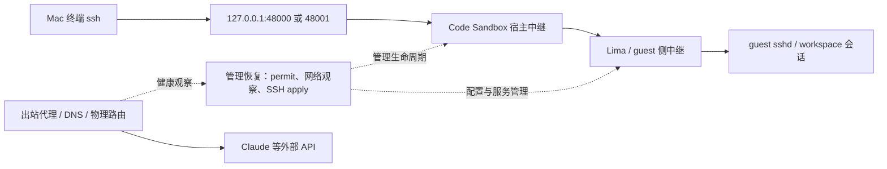

# Code Sandbox 两个沙箱 SSH 反复中断：原因分析与修复建议

> 公开脱敏版。保留调查结论、证据限制与修复建议；具体实例名已匿名化，原始日志由报告作者留存，不随本文公开。本文讨论本机开发工具问题，不涉及 PGRAC 产品内部设计。

日期：2026-10-14。范围：2026-10-13、2026-10-14 已有日志，采集截止约 10-14 15:00 CST。对象：`ssh 2`、`ssh claude2`。应用信息：Info.plist 为 0.5.4，daemon 自报 `0.5.4-beta.17`；宿主 macOS 27.0.1。

本文是只读故障分析和修复方案，**不是“已经修好”的交付**。本轮未修改应用、SSH、VPN、NTP、代理或虚拟机配置，未停止、重启、重建沙箱，也未进行故障注入。现存数据、日志和旧调查材料全部保留。

## 1. 结论

**调查重点应放在 Code Sandbox 的管理恢复链路，而不能再用“Mac VPN 把 SSH 断了”概括全部事件。** 已确认多个可从日志精确定位的异常：

1. 两个 guest 反复拒绝控制凭据，明确报 `task permit was issued in the future`；网络对时已启用但未同步。10-14 睡眠/唤醒窗口，两端出现管理脚本执行、SSH 配置重载、workspace 会话同秒关闭。
2. 10-14 11:23:55，宿主出现系统级文件句柄耗尽，Code Sandbox 写代理凭据和读状态文件失败；之后出现持续 15 分钟的配置等待循环，以及大量 SOCKS 认证失败，包含 Claude API 域名的 DNS 请求。
3. 管理恢复还出现 `limactl not found in PATH`；macOS/Lima 日志却把流中断描述为 WSL 服务重启。这些是可直接提交给开发者的恢复路径和诊断问题。

**尚未查到关闭用户长连接的具体调用栈，因此不能宣布一个已完全证实、覆盖所有断线的单一代码根因。** 目前最强假设是：睡眠/路由/凭据异常触发管理重新收敛，管理中继的替换或取消与用户 SSH 会话生命周期发生耦合。需要开发者在该路径补齐关闭原因，验证并修复；不能仅凭 `sshd SIGHUP` 认定它杀死长连接。

昨天另有明确的沙箱停启/管理服务恢复窗口，必须与运行期的异常断线分案。当前两个别名映射正确、均可登录，不能把保留下来的旧 Lima 目录当作现用映射错误。

## 2. 实际连接结构与当前状态

| 入口 | 本机监听 | 当前 Lima 实例 | 当前生命周期 |
|---|---|---|---|
| `ssh 2` | `127.0.0.1:48000` | 沙箱 A（Lima） | running / ready，generation 3 |
| `ssh claude2` | `127.0.0.1:48001` | 沙箱 B（Lima） | running / ready，generation 3 |

两个端口由宿主 `code-sandboxd` 管理。14:42–14:51 的短连接检查中，两端 SSH 命令均以退出码 0 完成，端口探测各 3/3 成功。这只证明检查时可用，不证明长连接稳定。

这是按配置、进程和日志整理的逻辑结构，不是逐包抓包结果。**SSH 第一跳是本机 loopback，并非必经美国 VPN 节点。** VPN/TUN 可以影响出站路由、授权请求以及管理恢复判断，进而间接影响本地中继；本次没有证据证明它直接切断全部本地 SSH TCP 流。

当前宿主 daemon 自 10-13 22:06 持续运行，两个 Lima 主进程分别自 22:07、22:32 持续运行。目标两个沙箱的 lifecycle 操作记录中，10-14 截止采集时没有新的 start/stop/restart；guest boot 身份与 current 状态一致。这支持“今天不能一概解释为 VM 反复重启”。数据库中其他沙箱的操作不属于本报告对象。

## 3. 分事件时间线

时间统一展示为北京时间 CST。guest 原日志部分为 UTC 或 `-07:00`，已转换；**guest 墙钟本身有异常迹象，跨主客机的精确先后仍有误差**。同机事件顺序比跨机毫秒差可靠。

| 时间 | 已有证据 | 可以得到的结论 |
|---|---|---|
| 10-13 18:00–18:21 | 初始化出现 SSH exit 255、`init_policy_invalid`、host bridge 健康失败；另有 `retaining session` | 包含新沙箱构建/恢复问题；不能把它们全部算作正常运行中随机断线 |
| 10-13 22:02–22:33 | guest 控制 WebSocket EOF/连接拒绝；lifecycle 有明确的失败 stop、成功 stop、restart；宿主 daemon 22:06 重新启动 | 这一段确实有管理/虚拟机生命周期操作，可能正常终结连接；该窗口也包含用户批准的维护操作，不据此指控自动崩溃 |
| 10-13 23:19–23:21 等窗口 | 已运行实例反复出现 `managed SSH guest apply`，guest sshd 多次 SIGHUP | 证明运行期多次重新应用 SSH 配置，是否不必要需核对配置差异；未逐条绑定用户终端中断 |
| 10-14 07:41–08:51 | Mac 合盖睡眠、DarkWake、网络连接丢失标记，08:51 FullWake；guest 出现 future permit 拒绝 | 睡眠/恢复与授权时间检查异常同时存在；当前时间对得上不能排除当时偏差 |
| 10-14 07:51:28 | 两个 guest 管理账号执行 root 脚本，重载 ssh，多个 workspace 会话同秒关闭 | 是管理重应用与连接关闭的重要关联窗口；具体 close/cancel 发起者仍缺证 |
| 10-14 11:23:55 | 写 SOCKS 凭据和读隔离 Claude 状态均报 `too many open files in system` | 系统文件表耗尽确实影响应用；尚不知是哪一进程造成资源耗尽 |
| 10-14 11:23:58–11:38:58 | 每约 5 秒报“代理配置已变化，等待当前配置恢复”，共 181 行 | 持续 15 分钟未在该路径恢复正常；不能把重试当恢复成功 |
| 10-14 11:39:11 | `limactl not found in PATH` 后将网络报告为 offline | 恢复路径存在可定位的工具解析失败，不能把这条等同真实物理网络断开 |
| guest 时间 10-14 11:39:05–12:27:24 | `socks5: incorrect user name or password`，包括 `api.anthropic.com` 的 DNS 查询 | 已证出站代理认证故障，能解释这部分 API/DNS 失败；不是单凭该日志就能证明 SSH 被关闭 |
| 10-14 14:15–14:16 | 两端物理出口发现失败；guest sing-box 停启；随后两端 managed SSH apply、sshd 重载 | VM 未重启时仍有代理/管理重配置；谁触发、是否必需、是否取消旧 SSH relay 需开发者核调用链 |

原始 host 日志、guest journal、生命周期记录和计数结果由报告作者留存。本公开版不上传运行日志，也不提供仅在本机有效的附件链接。

### 防止日志误读

- host 日志会重放 guest 旧消息。例如 host 14:16:05 收到的认证错误，内嵌 guest 时间为 UTC 04:27:24（CST 12:27:24）。不能据此声称该错误新发生在 14:16。
- 共取到 8,869 行 SOCKS 认证错误，按内嵌消息文本去重为 7,481 条；这是日志计数，**不是失败连接数、SSH 中断数或独立事故数**。
- 10-13 23:20:34 的 claude2 的一条 workspace 会话 在约 0.2 秒内开闭，可能是短命令/管理探测；不把它当作用户长连接断线证据。
- 系统日志中的 `session closed`、正常 SSH 探测的 EOF 和本地 stdin `Broken pipe`，不能脱离退出码、PID 与调用目的单独定事故。
- 旧 `Host claude` 仍有指向不存在 ssh.config 的直接 ProxyCommand，能够解释它自身的 awk/nc 错误；现用 `2`/`claude2` 走管理端口，不能把旧问题移植到本轮。

## 4. 缺陷分析及应修的位置

没有取得与安装二进制匹配的 Code Sandbox 源码，以下给出**日志入口与责任模块**，不编造源码文件行号。修改必须先在源码中找到相应调用者并建立定向失败测试。

### A. 授权时间异常与恢复期间的会话生命周期

**事实：** guest 中 `issued in the future` 日志分别 40/80 条；两端 `NTP=yes`、`NTPSynchronized=no`，既有 clock 原件显示 NTP 回复超时、Packet count 为 0。宿主同时出现 `permit_rejected`、观察授权无效/过期及 containment fail-closed。

**判断：** 已确认控制凭据时间校验失败。睡眠恢复后的时钟差、签发/验证时间来源、过期管理状态都是应核对的上游，尚无现场签发时刻/验证时刻/容差三值，不能唯一指定为“guest 慢了多少秒”。对时状态应表述为“已开，但未成功同步”。

**修复方案：**

1. 在 resume/重连时，先完成受认证的主客机时间/boot 身份校验，再签发新 nonce 的控制凭据；验证失败要有明确可恢复状态和有界重试，不反复用失效凭据执行同一动作。
2. 区分“观察暂时不可得”和“已经证实撤销/身份改变”。前者不应被直接升级为用户会话销毁；真正授权过期、撤销及隔离策略仍按明确合同执行。先查现有安全合同，不能为了不断线接受无效 permit。
3. 同 boot、同有效授权、同 SSH 配置下的观察重试，不应反复销毁/替换用户 relay。管理动作应与业务会话分别持有生命周期，避免一个观察 RPC 的 timeout/cancel 取消全部流。
4. 不以无限放大时间容差、关闭签名校验或关闭 containment 修复。单调时钟只用于本机期限；跨主客机签名时间须单独解决可信时间和重连校验。

Go 的时间序列化不携带进程内的单调时钟部分，因此“把跨机时间差改成单调钟相减”不是可行修法；睡眠行为也须单独验证。[Go time 官方文档](https://pkg.go.dev/time#hdr-Monotonic_Clocks)

### B. SSH 重应用/relay 替换是否错误终结已有会话

**事实：** 10-14 07:51:28 两端同窗管理重应用和 workspace 会话关闭。依据为两个 guest 的完整 journal 归档：管理脚本、sshd reload 与 workspace 会话关闭均出现在该秒。原始归档未公开。

**最值得验证的机制：** 网络恢复重新运行 managed SSH apply，导致旧 relay 上下文、子进程或管道被替换/取消；用户 SSH 看到的就是 `Connection closed by remote host`。但缺少 connection ID 和关闭发起者，此机制仍为推断。

**修复方案：** 配置应用必须幂等；配置身份未变不重载、不换 relay。必须替换时先验证新实例/目标 boot，明确旧流保留或终止政策。SSH 流不能隐式归属于一次网络健康检查的短期 context。旧代次的异步 cleanup 不得关闭新代次监听器/流。

**不能采用的捷径：** 看到 SIGHUP 就直接删掉所有 reload。OpenSSH 为连接派生处理进程，监听进程收到 SIGHUP 会重新执行并读取配置；这并不单独证明现有用户连接会被杀死，须查进程组、服务单元和 relay 生命周期。[OpenSSH sshd 手册](https://man.openbsd.org/sshd)

### C. 凭据更新遇资源错误后的恢复与一致性

**事实：** daemon 10-14 日志第 32 行写 `host-proxy-socks-credential.json` 失败；backend `.1.log` 第 31783 行读状态文件失败；紧接配置等待循环，随后有 SOCKS 认证错误。

**已证边界：** `too many open files in system` 对应系统级 ENFILE，不能直接宣称 Code Sandbox 自身 FD 泄漏；要查事故时全系统/各进程 FD 持有情况。EMFILE 才是另一类进程 FD 限额错误。[Apple open(2) 手册](https://developer.apple.com/library/archive/documentation/System/Conceptual/ManPages_iPhoneOS/man2/open.2.html)

**修复方案：**

- 代理凭据按 active/staged 代次发布，文件写入、双方载入/确认未完成时，不把新代次标成 active；失败保留仍有效的一致代次，或明确进入不可用并可靠恢复，不能无限“等待当前配置恢复”。不能把旧凭据永久有效当恢复策略。
- 检查持久文件、宿主 SOCKS listener、guest outbound 三者是否部分更新。当前先后关系提示这条问题，但**尚未证明哪一端先切换**，需要故障注入验证。
- 故障恢复采用有界退避与错误分类；资源恢复后能重新读取/写入并重新认证，而非依赖用户重启应用。
- 排查日志流、WebSocket、exec 管道、端口转发和失败重试的 FD 释放。记录峰值与所有者后才决定修泄漏或容量；单纯提高 ulimit 不是根因修复。

该项同时关联 Claude 的 EAI_AGAIN/DNS 表象：日志已显示 DNS 通过 SOCKS outbound 时认证失败，因此不能只换 DNS 服务器。并非已证明用户每一次 EAI_AGAIN 都来自这条链。

### D. 恢复路径依赖错误的 PATH / 路由判断

**已证工具错误：** daemon 第 214 行在恢复路径找不到 limactl。正常运行的应用不应依赖终端交互 PATH 才能定位自身配套 runtime 工具。使用受验证的 bundled/安装绝对路径，并保留具体 exec errno；不要把工具缺失笼统报告成网络离线。

**路由问题：** `CS-LICENSE-PHYSICAL-ROUTE-001` 与“竞争 TUN 后未找到真实物理默认出口”多次出现。恢复代码需要分别处理物理出口、代理出口、guest 管理链路和授权服务；不能把其中一个探测失败当所有路径同时失效。

同时，日志明确存在 `reusing healthy proxy` 和 `retaining session`。这说明产品已有部分保留策略，修复应追查进入破坏性重应用的具体分支，不应声称“它所有网络异常都会关连接”，也不应一律禁止必要的隔离或凭据撤销。

### E. 诊断缺陷：无法可靠解释自己关闭了哪条连接

macOS/Lima 日志把日志流中断写为 WSL 服务瞬态重启，这是错误的平台提示，不能拿它证明 VM 重启。此次最缺的是 SSH relay 终结日志。

建议在现有 owner 中记录：`sandbox_id`、runtime generation、boot、relay/connection ID、创建者、关闭发起模块、原因枚举、context cancel 原因、子进程退出码、两端 EOF/错误、配置代次是否改变。permit 错误记录时间差和允许窗口，不记录 token。凭据只记录代次，不记录口令；ENFILE 记录资源统计与失败阶段。

## 5. 修复顺序与最小验收

这是交给开发者的实施顺序，**下面的故障测试本次均未运行**，应在独立可丢弃环境验证，避免打断当前工作沙箱。

| 顺序 | 工作 | 定向验证与通过条件 |
|---|---|---|
| 1 | 补 relay close 与恢复原因，稳定对应实际长会话 | 两沙箱各一条持续 SSH；每次异常能定位到精确连接、首个错误和关闭 owner，正常短命令不误算掉线 |
| 2 | 修 permit/睡眠恢复以及 SSH apply 幂等性 | 有效身份下临时观察失败、配置重复应用不主动销毁已有 SSH；睡眠恢复能取得新的合法凭据；过期、撤销、错误 boot/签名仍拒绝 |
| 3 | 修代理凭据更新失败与资源恢复 | 分别在文件写入/组件载入阶段注入 ENFILE、EMFILE、写盘失败；无半代次发布，资源恢复后自行恢复，既有本地 SSH 不受无关出站认证故障波及 |
| 4 | 修 runtime 工具解析与路由分类 | 最小 PATH、TUN 切换、物理网络短失联分别测试；错误正确分类，不误判 VM 死亡；无新增网络泄漏 |
| 5 | 双沙箱长会话回归 | 同时持续会话，覆盖一次配置恢复、一次主机睡眠唤醒；区分传输自然失效、应用主动关闭及授权撤销；测应用主动中断数和恢复耗时 |

睡眠期间操作系统、传输或网络可能自然超时，不能承诺任意长睡眠下原 TCP 永不掉。修复验收应保证应用不无故增加断线、恢复后入口可用且工作会话可恢复，而不是用无限 TCP/授权超时制造通过。

主动执行 stop/restart 的测试单列：它允许连接终止，但必须能解释原因、恢复入口并保留数据，不能混入“无用户操作的随机断线”统计。

## 6. 当前可用的缓解措施

这些不是根因修复，本轮未替用户更改设置。

- 两个沙箱已有 tmux，可用 `ssh -t 2 'tmux new-session -A -s work'`、`ssh -t claude2 'tmux new-session -A -s work'` 保留普通 SSH 中断后的 shell/任务。它不能保护 VM 重启或管理器终止进程。
- 工作时避免 Mac 合盖睡眠；已有 caffeinate 未阻止本次合盖事件，不能把它当绝对保证。
- SSH keepalive 用来探测死连接，不能阻止管理器主动取消 relay，也不能修复无效 permit 或代理密码不一致。
- 暂时稳定 VPN 节点/路由可减少变量，但不能据此宣布解决 Code Sandbox 恢复问题；不建议绕过应用隔离策略或关闭授权校验。

## 7. 原件、局限与交付状态

调查保留的证据包括：

- 10-13、10-14 的宿主应用日志，保留原时间与行号。
- 两个 guest 的服务 journal、原完整 journal 片段、boot 身份及当前 SSH/对时配置。
- lifecycle 记录、Mac 电源/睡眠记录、日志计数和时区转换结果。

服务 journal 采集退出码为 0、stderr 为空；按 unit 过滤不等于全系统 journal，不能用它缺某个 PAM 事件推翻早先完整 journal。此前材料和本次原件均未覆盖或删除。公开版没有上传运行目录、原始凭据、配置文件或日志附件。

尚缺：用户每次中断的精确时刻/对应连接 PID、socket FIN/RST 与 relay close 发起者、事故时 FD 所有者、当时主客机签发/验证时间差、与安装版本对应的源码。没有这些证据，不能准确指到一个已验证的源码 bug 行号，也不能保证单改某个开关就根治。

**交付结论：已找到具体的授权恢复失败、资源错误后的代理认证故障及 runtime 工具解析问题，足以形成修复任务；SSH 用户长连接的精确关闭调用仍待补证。没有证据支持“都是 VPN”或“都只是 SSH 空闲超时”。诊断期间未实施修复、未重启任何沙箱；本次公开的是脱敏报告。**
